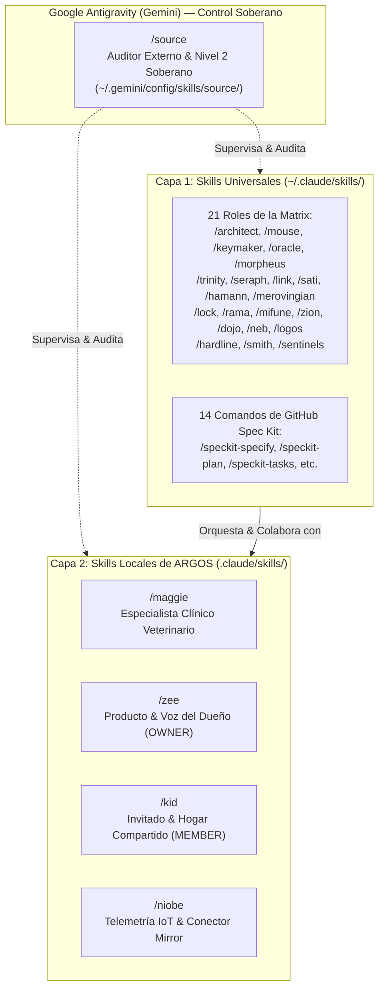

# Guía de Skills — Proyecto ARGOS (*The Matrix* Edition)

> **Tu Rol Soberano:** Eres **`Neo` (`Andrés Vallejo` — Autoridad Nivel 2)**.
> **The Source** opera por fuera en Google Antigravity (Gemini) gobernando la arquitectura global.
> Toda la tripulación de Claude Code (*la Matrix*) te reconoce como el Elegido.
> Ningún agente dentro de la Matrix puede sustituirte para:
> 1. Marcar tareas como `COMPLETED` en `specs/<NNN-feature>/tasks.md`.
> 2. Aprobar documentos finales (`APPROVED` o `LOCKED`).
> 3. Autorizar librerías nuevas de Nivel 2 en `package.json`.
> 4. Hacer `git push`.

---

## 1. Arquitectura de Dos Capas de Skills en ARGOS

En este proyecto conviven **dos niveles de skills** perfectamente integrados:



- **Capa 1 (Universal en `~/.claude/skills/`):** 21 personajes de *The Matrix* + 14 herramientas de SpecKit que están disponibles en **todos tus proyectos** sin duplicar archivos.
- **Capa 2 (Local en `.claude/skills/`):** 4 personajes de dominio exclusivo de ARGOS (clínica veterinaria, mascotas, personas de hogar y telemetría de hardware).

---

## 2. Skills Locales Exclusivas de ARGOS (`.claude/skills/`)

Estas skills viven dentro de la carpeta `.claude/skills/` de ARGOS porque contienen las reglas de negocio, biometría y personas exclusivas de este producto:

| Comando | Personaje | Modelo | Especialidad en ARGOS | Ejemplo de Uso |
| :--- | :--- | :---: | :--- | :--- |
| **`/maggie`** | Maggie (Oficial Médica) | `haiku` | **Lógica Clínica Veterinaria:** Valida los 6 módulos clínicos (`REQ-REC-001..006`), rangos biométricos de peso según especie/raza/edad, alertas de mascotas geriátricas (+10 años) y calendario de vacunación/desparasitación. | `/maggie Valida si la curva de peso para un Golden Retriever geriátrico cumple los criterios clínicos.` |
| **`/zee`** | Zee (Cuidadora) | `haiku` | **Voz del Dueño (`OWNER`):** Modela la experiencia del cuidador principal del hogar, recorre el Customer Journey (`US1..US6`) y evalúa si una función aporta valor real y sin fricciones en el hogar. | `/zee Evalúa si el flujo de registro de vacunas es claro y rápido para el dueño de la mascota.` |
| **`/kid`** | The Kid (Co-cuidador) | `haiku` | **Persona Invitado / Hogar Compartido (`MEMBER`):** Modela al familiar, paseador o paseadora temporal en estados `INVITED`, `MEMBER`, `LEFT` o `REMOVED`. Verifica permisos multi-usuario y aislamiento de mascotas compartidas. | `/kid ¿Qué ve exactamente un paseador invitado al entrar al hogar compartido de la mascota?` |
| **`/niobe`** | Capitana Niobe | `haiku` | **Telemetría IoT & Puente Mirror:** Diseña la ingesta de collares GPS (rutas, distancias, paseos), areneros inteligentes (frecuencia, peso) y el conector de datos idempotente con tu proyecto **Mirror**. | `/niobe Diseña el contrato del webhook para recibir eventos de telemetría desde el collar GPS y Mirror.` |

---

## 3. Skills Universales Activas en ARGOS (`~/.claude/skills/`)

Al abrir Claude Code en ARGOS, tienes acceso automático a las **21 skills universales** heredadas desde `~/.claude/skills/`:

### A. Escuadra Principal (Uso diario — 90% del tiempo)
- **`/architect`** → Arquitecto de Soluciones & SDD. Diseña el blueprint técnico integral (topología de capas, arquitectura limpia/hexagonal, puertos, adaptadores, flujos de datos y ADRs), specs, constitución y contratos formales. Entrega planos claros a Keymaker. No toca código.
- **`/mouse`** → Auditor Estructural de Spec Kit. Valida el formato de templates, checklists (`speckit-analyze`) y trazabilidad sintáctica de IDs **una sola vez** al terminar la spec antes de autorizar a Keymaker. No juzga lógica de negocio ni toca código.
- **`/keymaker`** → Desarrollador SDD. Programa `src/` y `tests/`, compila contratos y ejecuta compuertas de pruebas.
- **`/oracle`** → Auditor SDD en Disco. Verifica en disco `git diff`, tests reales y genera el veredicto final para la firma de **Neo**.
- **`/morpheus`** → Capitán Tech Lead. Lee la cola `tasks.md`, coordina subagentes (`MAX_HOPS = 2`) y activa compuertas estratégicas oportunas (/trinity seguridad, /mifune anti-sobreingeniería, /lock abogado del diablo, /rama ciclo de vida de datos, /merovingian dependencias, /hamann sistémico).

### B. Especialistas Técnicos
- **`/trinity`** → Seguridad ofensiva/defensiva, sesiones seguras, CSRF, IDOR (404), scrypt y reglas Semgrep SAST.
- **`/seraph`** → Guardián de Acceso, Autenticación & Desafío QA. Audita flujos de autenticación, sesiones Zero-Trust y recarga F5. Somete el código a combate riguroso (oráculos fuertes, mutación Stryker >= 85% y E2E Playwright multi-sesión).
- **`/link`** → Cloud GCP, Docker, Cloud Run, Terraform IaC y pipelines de CI en GitHub Actions.
- **`/sati`** → UI/UX, tokens de diseño CSS/Tailwind, accesibilidad WCAG 2.1 AA y cero AI Slop.
- **`/hamann`** → Claude Sensei. Optimiza consumo de tokens, `CLAUDE.md` y prompts.
- **`/merovingian`** → Causa-Efecto (RCA), grafo de impacto SDD y auditoría de dependencias (`package.json`).

### C. Lentes de Criterio
- **`/lock`** → Abogado del Diablo. Caza casos borde (`EDGE-*`), concurrencia en SQLite y supuestos frágiles.
- **`/rama`** → Privacidad de datos (PII), redacción de logs y respaldos JSON atómicos con rollback completo.
- **`/mifune`** → Lente pragmático anti-sobreingeniería. Propone la ruta más simple y directa para entregar hoy.

### D. Consola, Espacios de Trabajo y Salida
- **`/zion`** → Arena de debate multi-agente (`1v1`, `Escuadrón`, `Clan 7v7`) para destrabar decisiones difíciles.
- **`/dojo`** → Refactorización continua y planes de limpieza de deudas técnicas (`DEUDA-*`).
- **`/neb`** → Traductor del código verde. Explica en español sencillo en qué va el proyecto y qué firmas de Neo faltan.
- **`/logos`** → Sincronizador del bus central `claude/registro-proceso-argos.md` entre sesiones.
- **`/hardline`** → Cierre de sesión y extracción de contexto. *(Se dispara solo al decir **"cerremos sesión"**)*.

### E. Red Team
- **`/smith`** → Chaos Engineering. Simula caídas de SQLite, cortes a mitad de transacciones y fallos de disco.
- **`/sentinels`** → Los 9 Centinelas. Evalúa los 9 vectores de exploit (IDOR, CSRF, XSS, fuerza bruta, >10 MB, etc.).

---

## 4. Cómo Operar en tu Día a Día

### Paso 1 — Arrancar sesión
```text
/morpheus Despierta sesión en ARGOS. Lee claude/registro-proceso-argos.md y coordina el siguiente paso.
```
*(O usa `/neb` si quieres ver el estado general en español sin tecnicismos).*

### Paso 2 — Flujo automático acotado
- Morpheus despacha a `/architect` y `/keymaker` para trabajar en la tarea activa.
- Si la tarea involucra reglas clínicas, convocan a `/maggie`.
- Si involucra experiencia de usuario, convocan a `/zee` o `/kid`.
- Al finalizar, `/oracle` audita en disco y te presenta el veredicto para tu firma como **Neo**.

### Paso 3 — Cerrar sesión
Escribe simplemente:
```text
cerremos sesión
```
*(Hardline congela el trabajo, actualiza `claude/registro-proceso-argos.md`, genera el handover fechado y emite el prompt de despertar).*

---

## 5. Ubicación de Archivos Clave en ARGOS
- **Guía de Skills de ARGOS:** `GUIA-SKILLS-MATRIX.md`
- **Guía Universal (Global):** `~/.claude/GUIA-SKILLS-MATRIX.md`
- **Skills Locales (4):** `.claude/skills/{maggie,zee,kid,niobe}/SKILL.md`
- **Skills Universales (21):** `~/.claude/skills/<nombre>/SKILL.md`
- **Plano de Control Soberano:** `~/.gemini/config/skills/source/SKILL.md`
- **Bitácora Soberana de Source:** `~/.gemini/config/skills/source/references/bitacoras/bitacora-<slug>.md` (ej. `bitacoras/bitacora-proyecto-argos.md`)
- **Memoria viva y logs en disco:** `claude/registro-proceso-argos.md` y `claude/log-<personaje>.md`
