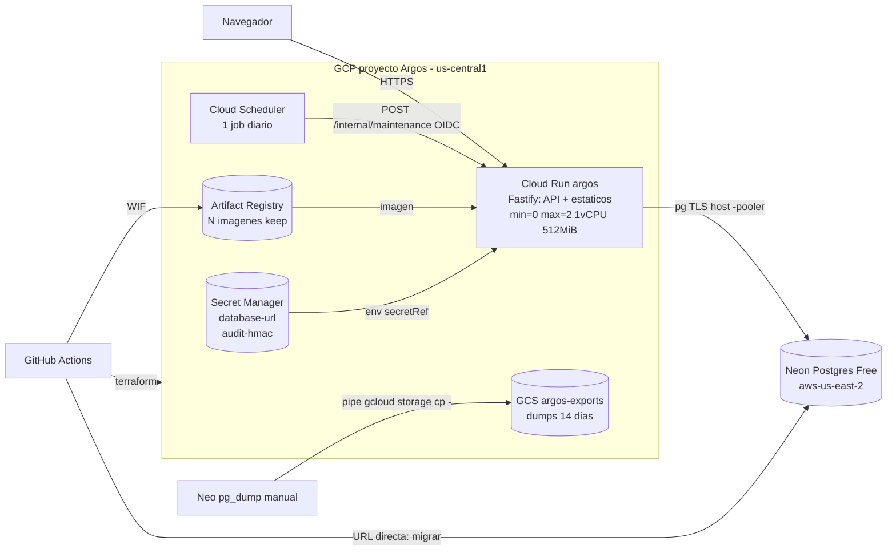
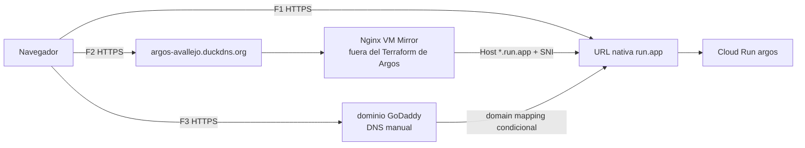

# Implementation Plan: Argos en la nube — GCP, Neon, Terraform y CI/CD (Feature 003)

**Estado**: `APPROVED` (Aprobada por Neo (Level 2) el 2026-11-15, bajo condiciones R1 a R5 del veredicto Oracle); no `LOCKED`. **Spec**: `spec.md`. **Investigación**: `research.md`. **Modelo físico**: `data-model.md`.
**Lenguaje/Runtime**: TypeScript, Node 22.23.4 (`.nvmrc`; 22.23.5 existe desde 2026-11-11 y se reevalúa al implementar, H-MERO-015), Fastify 5, `pg` 8.23.1 (nuevo, Nivel 2, D-27), Vite/React (sin cambios). **Alcance IaC**: Terraform 1.17.2, proveedor `hashicorp/google` 7.46.2 exacto con `.terraform.lock.hcl` versionado (D-25, resuelta por Neo el 2026-11-15; BUSL-1.1 anotada).
**Regla**: ninguna decisión de este plan se implementa sin tarea de `tasks.md`; ningún ADR sustituye a Neo en los puntos `[N2]`.

## 1. Arquitectura



Capas (sin cambios en `domain/` ni `application/`): `presentation` → HTTP cliente generado; `infrastructure/http` (Fastify + nuevas rutas operativas) → `application` (puertos) ← `infrastructure/persistence/{memory,sqlite,postgres}`. `server.ts` es la única raíz de composición y elige el adaptador por `ARGOS_DB_DRIVER` con **carga dinámica** (`await import()`): con Postgres, `better-sqlite3` (módulo nativo) no se carga ni viaja en la imagen de producción (H-MERO-006). `domain/` y `application/` no cambian. Las cabeceras de seguridad (CSP, `nosniff`, `Referrer-Policy`, `Cache-Control`) y la defensa de *traversal* de los estáticos viven en `infrastructure/http` con código propio, sin `@fastify/helmet` (REQ-CLD-009, H-MERO-013).

### 1.0 Frentes de exposición (F1..F3)

F1 es el frente principal (sin Load Balancer, certificado automático, costo 0). F2 vive en Mirror (REQ-CLD-010) y Argos solo lo verifica desde fuera (T483). F3 es `google_cloud_run_domain_mapping` con `count = var.custom_domain != "" ? 1 : 0` (REQ-IAC-014; `us-central1` admite mapeos; estado Preview y gratuidad no confirmada, ver ADR-003-18).

### 1.1 Flujo de una solicitud (cold path)
Cliente → Cloud Run (instancia fría: arranque Node, `loadAppConfig`, `createDummyHash`, `pg.Pool` perezoso) → `GET /auth/me` → `runInTransaction` → pooler Neon (reanuda cómputo si estaba suspendido) → respuesta. El pool es **perezoso**: `startup probe` solo toca `/healthz` (sin base ni `schema_migrations`) para no despertar Neon ni caer en bucle de reinicios con Neon agotado; `/readyz` y el primer caso de uso abren la conexión y verifican el esquema con criterio de subconjunto (ADR-003-05).

### 1.2 Estructura de carpetas (nuevos artefactos)

```text
Dockerfile                          # multi-etapa (REQ-CLD-001)
.dockerignore
docker-compose.test.yml             # Postgres 17 solo para pruebas
scripts/migrate-postgres.ts         # ejecutor de migraciones (URL directa)
src/infrastructure/persistence/postgres/
  postgres-database.ts  postgres-repositories.ts  postgres-unit-of-work.ts
  migrations/0001_baseline.sql                      # esquema final completo, baseline único (D-20)
src/infrastructure/http/routes/ops-routes.ts       # /healthz /readyz /internal/maintenance
src/infrastructure/http/oidc-verify.ts              # funcion verifyOidc(token) inyectada en ops-routes (sin puerto, H-MIF-005)
# salida de compile-contracts --feature 003: src/generated/ops/ (nunca src/generated/api, H-MERO-003)
terraform/                          # raiz plana, sin modulo ni locals (H-MIF-004)
  provider.tf  backend.tf  variables.tf  outputs.tf  services.tf  cloud_run.tf
  artifact_registry.tf  secret_manager.tf  iam.tf  buckets.tf  scheduler.tf
  README.md  bootstrap.sh
.github/workflows/
  auto-pr.yml  infraestructura.yml  deploy-argos.yml  code-quality.yml  vacuum-argos.yml
  test-gate.yml (+workflow_call)  drift-detection.yml (sin cambios)
```

## 2. Terraform

### 2.1 Convenciones (raíz plana, H-MIF-004)
Un solo directorio `terraform/` con un archivo por servicio GCP, sin `module "argos_platform"`, sin `modules/` y sin catálogos `locals`: los valores van literales y usan `var.project_prefix`. `provider.tf` y `backend.tf` iguales en forma a Mirror; variables `TF_VAR_*`. Se pierde la paridad de estructura con Mirror y la opción de un segundo entorno sin refactor (D-01: un proyecto).

```hcl
# backend.tf
terraform { backend "gcs" {} }
# CI: terraform init -backend-config="bucket=<D-12>" -backend-config="prefix=terraform/argos-state"
```

Reglas: etiquetas `app=argos`, `managed-by=terraform` en todos los recursos etiquetables; `deletion_protection=true` en el servicio; `prevent_destroy` en secretos y bucket; `google_project_service` solo con las APIs de REQ-IAC-009.

### 2.2 Recursos y valores
| Recurso | Valores | Costo |
|---|---|---|
| `google_cloud_run_v2_service.argos` | `ingress=INGRESS_TRAFFIC_ALL`, `template.scaling{min=0,max=2}`, `cpu=1`, `memory=512Mi`, `cpu_idle=true`, `startup_cpu_boost=true`, `max_instance_request_concurrency=20`, `timeout=60s`, cuenta de ejecución, imagen marcadora **sin sondas propias ni `secret_key_ref`**; `ignore_changes` sobre `traffic`, `client`, `client_version`, revisión, etiquetas, anotaciones, imagen, env, sondas y secretos (ADR-003-11). Sondas `/healthz`, env y secretos con versión numérica los fija `deploy-argos.yml` | Dentro del cupo (NFR-CLD-004) |
| `google_artifact_registry_repository.argos` (DOCKER, `us-central1`) | una sola `cleanup_policies` `keep` de N versiones recientes (N=5 provisional, se fija tras medir en T434; sin regla `delete` por antigüedad); `cleanup_policy_dry_run=false` | 0,5 GB gratis |
| `google_secret_manager_secret` x2 + versión sin `count` | replicación `auto`; `prevent_destroy`; versión con `create_before_destroy` y `deletion_policy` de no destruir; variable con `validation` (no vacía); sin rotación automática | 2 versiones (pocas más durante una rotación) |
| `google_storage_bucket.exports` | STANDARD, `us-central1`, `uniform_bucket_level_access=true`, `public_access_prevention=enforced`, ciclo de vida 14 d sobre `dumps/`, `soft_delete_policy` 0 s (H-RAMA-002) | Dentro de 5 GB compartidos |
| `google_cloud_scheduler_job.maintenance` | `0 6 * * *` `America/Bogota`, `http_target` POST con `oidc_token`; **único job** | 1 de 3 gratis (2 de Mirror) |
| Cuentas de servicio y roles | §5 | 0 |
| `google_cloud_run_domain_mapping.custom` (F3) | `count = var.custom_domain != "" ? 1 : 0`; omitido con `custom_domain = ""`; DNS de GoDaddy manual | Gratuidad no confirmada (Preview), opcional |
| `google_billing_budget` (D-13) | 1 USD, umbrales 50/90/100 %; requiere la API `billingbudgets.googleapis.com` (12ª de REQ-IAC-009) y `roles/billing.costsManager` de `argos-terraform@` sobre la cuenta de facturación | 0 |

### 2.3 Estado
`terraform/argos-state` en el bucket de D-12 (recomendado: bucket propio y versionado). El estado contiene valores de secretos (R-06): bucket privado, acceso solo a la cuenta de Terraform, `public_access_prevention=enforced`.

## 3. Cloud Run: configuración operativa

| Parámetro | Valor | Justificación |
|---|---|---|
| CPU/memoria | 1 vCPU / 512 MiB | scrypt y JSON de pocos usuarios; 1 GiB duplicaría GiB-s sin necesidad |
| Concurrencia | 20 | scrypt ocupa el *thread pool* de libuv (4 hilos por defecto); 20 evita encolar logins; con `pool.max=5` el cuello es Neon, no Node |
| Instancias | min 0, max 2 | Tope de gasto, de conexiones (2x5=10) y de abuso (R-07) |
| Timeout | 60 s | Respuestas son cortas; `lock_timeout` 10 s; `idle_in_transaction_session_timeout` 15 s; `SIGTERM` espera <= 7 s (gracia de Cloud Run 10 s **[verificar]**) |
| Facturación | por solicitud, `cpu_idle=true` | Único modo con cupo gratuito verificado |
| Arranque | CPU boost + probe `/healthz` (periodo 2 s, 10 intentos), fijada por el pipeline; en el primer `apply` solo la sonda TCP por defecto | Reduce cold start; evita fallo del primer `apply` (H-LOCK-005) |
| Entorno | `NODE_ENV=production`, `HOST=0.0.0.0`, `PORT` (Cloud Run), `COOKIE_SECURE=true`, `APP_TIMEZONE=America/Bogota`, `ARGOS_DB_DRIVER=postgres`, `ARGOS_PG_POOL_MAX=5`, `ARGOS_AUDIT_RETENTION_DAYS=730`, límites `EXPORT_*`/`INVITE_*` | REQ-CLD-005 |
| Secretos | `DATABASE_URL`, `ARGOS_AUDIT_HMAC_SECRET` por `secret_key_ref` con **versión numérica por despliegue** (nunca `latest`), fijada por el pipeline (D-05: `TF_VAR_*`) | Una revisión conserva su secreto: el rollback de tráfico lo recupera (ADR-003-08) |
| Salud | `/healthz` (liveness/startup y tráfico público, sin base), `/readyz` (humo de CI y diagnóstico; caché en memoria de 60 s, sin OIDC; D-17) | REQ-CLD-004 |

## 4. Architecture Decision Records

| ADR | Decisión | Alternativas descartadas | Consecuencia |
|---|---|---|---|
| **ADR-003-01** | Un único contenedor: Fastify sirve API y `dist/`, con cabeceras de seguridad propias y `@fastify/static` en modo restrictivo (`dotfiles: 'deny'`, sin `list`; REQ-CLD-009). Sin Nginx ni CDN ni `@fastify/helmet` | Cloud Storage + CDN para el front (cuesta y rompe cookies de mismo sitio); dos servicios Cloud Run (dobles arranques en frío) | Una sola URL, cookies `SameSite=Strict` y CSRF sin cambios; `@fastify/static` (Nivel 2) |
| **ADR-003-02** | Neon Postgres Free como base operativa; `pg` estándar y cero API propietaria de Neon | Firestore (sin ACID relacional, reescribe repositorios); Cloud SQL (no gratis); SQLite en volumen/GCS (no concurrente, riesgo de corrupción) | Costo 0; ruta a Cloud SQL = cambiar `DATABASE_URL` (research §3) |
| **ADR-003-03** | Adaptador nuevo `persistence/postgres/`; SQLite y memoria intactos; misma suite de conformidad parametrizada x3 | Reescribir el adaptador SQLite; ORM (dependencia grande, Nivel 2) | Cero cambios en `domain/` y `application/` (NFR-CLD-009); SQL escrito a mano como en SQLite; carga dinámica del adaptador elegido (H-MERO-006). Alternativas a `pg` (`postgres` de porsager, `@neondatabase/serverless`) anotadas en `research.md §9` |
| **ADR-003-04** | Serialización por `pg_advisory_xact_lock` global al inicio de cada transacción + `lock_timeout` 10 s, nivel READ COMMITTED. **Topes de sesión (H-LOCK-003, H-LOCK-010)**: `idle_in_transaction_session_timeout` 15 s (`SET LOCAL` y a nivel de rol; T477 decide si basta el rol), `keepAlive` corto, `SIGTERM` <= 7 s; migrador con `lock_timeout` 5 s, 3 reintentos y `pg_try_advisory_lock` acotado a 60 s | `SERIALIZABLE` con reintento (casos de uso no son idempotentes en IDs y auditoría); `SELECT … FOR UPDATE` por fila (exige analizar los ~66 métodos de repositorio); confiar en el timeout TCP del sistema (horas); `pg_advisory_lock` sin límite | Paridad exacta con `BEGIN IMMEDIATE`; throughput de escritor único (aceptable para <= 3 usuarios). Una transacción zombi libera el candado global en 15 s; un `migrate` colgado no bloquea de forma indefinida. Es el cambio más delicado: prueba de concurrencia obligatoria (T427) |
| **ADR-003-05** | Migraciones fuera de la aplicación: paso `migrate` en el pipeline, URL directa, `pg_advisory_lock` de sesión, una transacción por archivo, *expand/contract*. **Verificación de esquema perezosa (H-LOCK-001)**: la app **no** verifica `schema_migrations` en el arranque; lo hace en `/readyz` y en el primer caso de uso, con criterio **esperadas ⊆ aplicadas**; `/healthz` no toca Neon. **Compatibilidad N-1 sin trabajo de CI (H-MIF-001)**: casilla *expand/contract* en el `code-review.md` de cada migración y una prueba en `tests/` que corre el código N-1 contra el esquema N solo cuando el PR toca `migrations/` | Migrar al arrancar (carreras entre instancias, cold start lento, rol con DDL en producción); verificar al arrancar (bucle de reinicios con Neon agotado); igualdad de conjuntos (rompe el rollback); trabajo `compat` por despliegue (descartado por `/mifune`: minutos de Actions y mantenimiento propios) | El despliegue puede retroceder el tráfico pero **no** la migración (solo avance); rollback de tráfico deja un servicio que arranca en frío; PITR 6 h nativo de Neon como red de seguridad (sin rama `pre-<sha>` ni `NEON_API_KEY`, D-19 resuelta) |
| **ADR-003-06** | Mantenimiento diario por Cloud Scheduler → `/internal/maintenance` (OIDC). Un solo job. El verificador OIDC es una función `verifyOidc(token)` inyectada en `ops-routes.ts` (H-MIF-005), no un puerto | `setInterval` en proceso (no corre con escala a cero); `min-instances=1` (consume el cupo y viola costo 0); puerto en `application/ports` (sin segundo consumidor real) | Sirve además como señal diaria de uso a Neon (R-05) sin keep-alive costoso; `src/application` sin cambios |
| **ADR-003-08** | Secretos: GitHub Secrets → `TF_VAR_*` → Secret Manager → Cloud Run por `secret_key_ref`. Estado de Terraform privado y versionado. **Versión numérica (H-LOCK-007)**: versión **numérica** de secreto por despliegue, validación y `trim` en CI; la rotación es un párrafo de runbook (REQ-SEC-008); HMAC solo ante compromiso | Solo contenedor en Terraform y versión por `gcloud` (D-05 a); variables en claro de Cloud Run; `latest` (una rotación defectuosa rompe todas las revisiones); rol alterno de Neon, destrucción a los 7 días y ciclo de 30 días propio (recortados por `/mifune`) | R-06 aceptado por petición de Neo; mitigaciones en §2.3; el rollback de tráfico recupera su secreto |
| **ADR-003-09** | Borrado físico en la nube: `DELETE` inmediato (inaccesibilidad lógica) + `VACUUM` tras cada eliminación o importación (`workflow_dispatch`) y semanal (cron). **Ventana de borrado = `max(PITR 6 h, próximo VACUUM <= 7 d, dumps 14 d)`** (H-RAMA-001; ya no se afirma «1 a 7 días dentro de la ventana PITR»). Buckets de dumps y de estado con `soft_delete_policy` en 0 s (H-RAMA-002). Ratificada por Neo (D-22 = A, 2026-11-15): inaccesibilidad lógica inmediata y purga física definitiva acotada a la ventana de 14 días (ciclo de dumps y `VACUUM`; R-14, Neo 2026-11-15). **Enmienda a ADR-002-13 (R4), aceptada por Neo (D-06 = A)**. **`VACUUM` por el rol propietario (H-LOCK-009)**: lo ejecuta `argos_migrator` en un flujo **semanal** (`vacuum-argos.yml`, H-MIF-011), no `argos_app` ni el endpoint de mantenimiento; evidencia con `pg_stat_user_tables` y prueba con centinela; `VACUUM (FULL, ANALYZE)` con `lock_timeout` solo en el disparo manual; versión de Neon verificada. **`/rama` reevaluó D-06: aceptable con condiciones C1..C6, aceptadas por Neo (D-22)**. *Precisión (T452a, decisión de Neo 2026-11-16, opción b; espejo de REQ-PG-011 en `spec.md`)*: el cron semanal es `VACUUM (ANALYZE)` simple, **sin `FULL`**, y por tanto solo recupera tuplas muertas para reutilización; **no purga los bytes del heap**. La ventana de 14 días depende del **disparo manual `workflow_dispatch` en modo `full` tras cada eliminación de cuenta**, que es un **recordatorio obligatorio con comprobación en el runbook** (se registra la ejecución y su `last_vacuum`). Es una precisión, no una contradicción con REQ-PG-015 ni con el `VACUUM (FULL, ANALYZE)` del disparo manual indicado arriba | Cifrado por usuario (cambio de modelo); `argos_app` con `VACUUM` (falla en silencio en PG < 17 **[verificar]**); confiar solo en `autovacuum`; rol dedicado `argos_maint` con `MAINTAIN` (PG 17 y un tercer secreto) | Garantía más débil que `secure_delete`; promete inaccesibilidad lógica inmediata y purga física definitiva acotada a la ventana de 14 días (`max(6 h, 7 d, 14 d)`), no `secure_delete`; una restauración puede resucitar cuentas eliminadas: REQ-PG-016 |
| **ADR-003-11** | Despliegue de la aplicación fuera de Terraform (`ignore_changes` sobre la imagen); revisión sin tráfico → humo → tráfico 100 %. **Propiedad dividida (H-LOCK-004, 005, 006)**: Terraform posee la «carcasa» (escala, recursos, cuenta, ingress); el pipeline posee imagen, env, sondas, secretos y tráfico; `ignore_changes` extendido; primer `apply` con imagen marcadora sin sondas ni secretos (bootstrap en dos fases); el guardia cubre `google_secret_manager_secret_version`; el plan falla ante una `TF_VAR` nula | Terraform despliega la imagen o todo (acopla CD a IaC y reasigna tráfico); `count` condicional sobre la versión (destruye la única versión) | Retroceso inmediato moviendo tráfico a la revisión previa; `apply` es inerte para el tráfico y las revisiones; el costo es verificar los atributos reales del proveedor en el ensayo único (T469) |
| **ADR-003-18** | Exposición en tres frentes: F1 URL nativa de Cloud Run (principal); F2 alias DuckDNS por el Nginx de Mirror (fuera del Terraform de Argos); F3 dominio de GoDaddy con `google_cloud_run_domain_mapping` condicional a `var.custom_domain` | Load Balancer global (costo); Terraform sobre la VM de Mirror (viola REQ-IAC-003); DNS de GoDaddy por Terraform (proveedor adicional, Nivel 2) | F2 depende de la disponibilidad de la VM de Mirror y de reescribir `Host` al nombre `*.run.app`; F3 es Preview y su gratuidad no está confirmada (se mide en T461); F1 siempre disponible |

### 4.1 Decisiones heredadas (sin ADR propio)
- Región `us-central1` (Cloud Run, AR, GCS, Scheduler) y Neon `aws-us-east-2`: decisión D-02 de Neo; RTT a medir en T459; reabrible. (Antes ADR-003-07.)
- Terraform desacoplado: estado propio, prefijo `argos`, `grep -ri mirror terraform/` = 0 (REQ-IAC-003); cupos compartidos con Mirror vigilados (R-03). (Antes ADR-003-10.)
- ADR-003-12 y las enmiendas ADR-003-13..17 se retiraron o se fusionaron en su ADR original (H-MIF-014); los números no se reutilizan.

## 5. IAM mínimo

| Cuenta de servicio | Roles | Alcance |
|---|---|---|
| `argos-run@` (ejecución) | `roles/secretmanager.secretAccessor` | Solo los 2 secretos de Argos (a nivel de secreto, no de proyecto). Sin rol sobre el bucket: la app no escribe en él (H-MIF-010) |
| `argos-deployer@` (GitHub, por WIF) | `roles/run.developer`; `roles/artifactregistry.writer`; `roles/iam.serviceAccountUser` | Servicio `argos`; repositorio `argos`; solo sobre `argos-run@` |
| `argos-scheduler@` | `roles/run.invoker` | Servicio `argos` |
| `argos-terraform-plan@` (GitHub, por WIF, PR) | roles de solo lectura (ver abajo) | Proyecto Argos y bucket de estado, solo lectura |
| `argos-terraform@` (GitHub, por WIF, solo `main` + Environment) | `run.admin`, `artifactregistry.admin`, `secretmanager.admin`, `iam.serviceAccountAdmin`, `storage.admin` (en sus buckets), `serviceusage.serviceUsageAdmin`, `cloudscheduler.admin`, `roles/billing.costsManager` (sobre la cuenta de facturación, no de proyecto; REQ-IAC-009) | Condicionados al proyecto Argos; **sin** `roles/owner` ni `editor` |
| Público (`allUsers`) | `roles/run.invoker` | Servicio `argos` (la autenticación es de la aplicación) |

Ninguna cuenta de Argos tiene permisos sobre recursos de Mirror. Con WIF, la condición del proveedor limita al repositorio `GITHUB_REPOSITORY` y a la rama `main` (y `refs/pull/*` solo para `plan` de solo lectura). **D-18 resuelta por Neo (2026-11-15), REQ-CICD-012**: se añade `argos-terraform-plan@` (solo lectura; `roles/viewer` acotado al proyecto y `storage.objectViewer` sobre el bucket de estado, sin escritura ni bloqueo de estado, `-lock=false` **[verificar roles mínimos en T469]**), usable por `pull_request` del mismo repositorio; `argos-terraform@` solo desde `refs/heads/main` con condición sobre `repository_id`, `repository_owner_id` y `job_workflow_ref`, y `environment: produccion` con aprobación de Neo. Limitación: el estado contiene secretos (R-06) y la cuenta de plan lo lee; riesgo aceptado con un contribuyente (`research.md` R-13).

## 6. CI/CD

### 6.1 Flujos
| Flujo | Disparador | Pasos | Estado |
|---|---|---|---|
| `auto-pr.yml` | `push` a rama de integración (D-09) | Construir cuerpo con commits acumulados; crear/actualizar PR hacia `main` por `gh`/REST | Nuevo (patrón Mirror) |
| `infraestructura.yml` | PR y `push` a `main` en `terraform/**` | `init` (backend GCS) → `fmt -check` → `validate` → `plan` con la cuenta de solo lectura → comentario en PR; en `main` (Environment `produccion`, aprobación de Neo, cuenta de escritura): `plan` y `apply` en el **mismo trabajo**, sin subir `tfplan` como artefacto (H-RAMA-006; reintento ante 409) | Nuevo |
| `deploy-argos.yml` | `push` a `main` en código/Docker; `workflow_dispatch` | `gate` (llama `test-gate.yml`) → `build-push` → `migrate` → `deploy` (revisión sin tráfico) → `smoke` → `promote` (tráfico 100 %) | Nuevo |
| `test-gate.yml` | PR/push a `main` y rama de integración | Sin cambios de pasos; se añade `workflow_call` | Modificado (N2) |
| `drift-detection.yml` | diario 06:00 UTC | Sin cambios | Se mantiene |
| `code-quality.yml` | PR a `main`, `push` a integración | `hadolint` y `actionlint` (Terraform lo cubre `infraestructura.yml`; TS lo cubre `test-gate`; sin `trivy`) | Adaptado |
| `vacuum-argos.yml` | semanal (cron) y `workflow_dispatch` (tras cada eliminación o importación) | `VACUUM (ANALYZE)` (cron) o `VACUUM (FULL, ANALYZE)` con `lock_timeout` (disparo manual) por tabla con `argos_migrator` por URL directa; falla ante `skipping … only table owner` o `last_vacuum` > 10 d; publica `last_vacuum` (REQ-PG-015) | Nuevo (N2) |
| `deploy-functions.yml` y flujos de VM de Mirror | — | **No aplican** (sin Cloud Functions ni VM) | Descartados (REQ-CICD-007) |

### 6.1.1 Cadena de suministro de CI (REQ-CICD-011, H-MERO-007/008/009)
- Acciones: lista con versión y SHA de 40 caracteres en cada flujo; por SHA las de credenciales (`google-github-actions/auth`, `docker/login-action`, `hashicorp/setup-terraform`) y las de terceros; etiqueta mayor solo para `actions/*`.
- `hadolint` y `actionlint` como binarios con versión y `sha256` fijos; `gitleaks-action` no se usa (SC-CLD-004 con `grep` o binario por `sha256`).
- `permissions:` por trabajo: `contents: read` por defecto; `id-token: write` permitido exclusivamente en `build-push` (autenticación WIF para push a Artifact Registry), `deploy` (despliegue a Cloud Run), `plan` (PR de `infraestructura.yml`, solo lectura, WIF con `argos-terraform-plan@`; REQ-CICD-012, SC-CLD-025) y `apply`; los trabajos `validate`, `gate`, `audit` y `migrate` permanecen estrictamente sin `id-token` ni credenciales OIDC.
- `npm audit --omit=dev --audit-level=high` en `code-quality.yml` y antes del despliegue; imagen base `node:22.23.4-slim@sha256:<digest>` (T433).
- `dependabot.yml` (solo `github-actions` y `docker`): propuesta a Neo, no incluida.

### 6.2 Esqueleto de `deploy-argos.yml` (normativo en forma, no en detalle)
```yaml
concurrency: { group: deploy-argos, cancel-in-progress: false }
jobs:
  gate:    { uses: ./.github/workflows/test-gate.yml }   # permissions: contents: read; SIN id-token ni secretos de GCP (H-MERO-009)
  audit:   { needs: gate }      # npm audit --omit=dev --audit-level=high; permissions: contents: read; SIN id-token
  build-push: { needs: audit }  # permissions: id-token: write (WIF); buildx; push <region>-docker.pkg.dev/<proj>/argos/argos:sha-${{ github.sha }}
  migrate: { needs: build-push }     # node scripts/migrate-postgres.ts con DATABASE_URL_DIRECT; sin rama Neon pre-<sha> (D-19)
  deploy:  { needs: migrate }   # permissions: id-token: write (WIF, despliegue a Cloud Run); gcloud run deploy --image … --no-traffic --tag sha-<corto> con sondas, env y secretos NNN numéricos
  smoke:   { needs: deploy }    # curl /healthz y /readyz en la URL etiquetada
  promote: { needs: smoke }     # gcloud run services update-traffic --to-latest
```
Si `smoke` falla, `promote` no corre y el tráfico sigue en la revisión anterior (SC-CLD-006). Si `migrate` falla, `deploy` no corre (SC-CLD-007).

### 6.3 Mapa de secretos y variables de GitHub (guía de bootstrap del día 0)
Regla: **todo se crea en el bootstrap del día 0 (`terraform/bootstrap.sh` y la consola de GitHub); nada queda pendiente de inventar** (REQ-CICD-006). La lista de Neo son las cinco primeras filas; las demás se derivan de decisiones ya tomadas.

| Nombre | Tipo | Valor / origen | Uso |
|---|---|---|---|
| `TF_VAR_database_url` | **secreto** | URL de Neon con `-pooler`, rol `argos_app` | Secret Manager (`argos-database-url`) |
| `TF_VAR_audit_hmac_secret` | **secreto** | >= 32 bytes hex (REQ-SEC-002) | Secret Manager (`argos-audit-hmac-secret`) |
| `TF_VAR_project_id` | variable | ID del proyecto GCP nuevo (D-01) | `var.project_id` |
| `TF_VAR_region` | variable | `us-central1` (D-02) | `var.region` |
| `TF_VAR_billing_account` | variable | ID de la cuenta de facturación (`ARGOS_BILLING_ACCOUNT` de `bootstrap.sh`; no sensible, REQ-IAC-009) | `var.billing_account` (presupuesto) |
| `TF_VAR_custom_domain` | variable | **valor inicial vacío `""`** (F3 desactivado) | `var.custom_domain`; `count = 0` mientras sea vacío |
| `DATABASE_URL_DIRECT` | secreto | URL directa sin `-pooler`, rol `argos_migrator` | Solo `migrate` y `vacuum-argos.yml` |
| `GCP_WIF_PROVIDER`, `GCP_DEPLOY_SA`, `GCP_TERRAFORM_SA`, `GCP_TERRAFORM_PLAN_SA` | variable | Salidas de `bootstrap.sh` | Autenticación WIF (D-05, D-18; sin `GCP_SA_KEY`) |
| `TF_STATE_BUCKET` | variable | Bucket de D-12 | `-backend-config` |

`NEON_API_KEY` y `NEON_PROJECT_ID` **no existen** (D-19). `project_prefix` usa su valor por defecto `argos` y no necesita variable de GitHub. Los flujos pasan `env: TF_VAR_custom_domain: ${{ vars.TF_VAR_custom_domain }}`; si GitHub rechazara crear una variable con valor vacío **[verificar en T456]**, se omite la variable: un `vars.*` inexistente se evalúa como cadena vacía y `var.custom_domain` toma su valor por defecto `""`. La validación de `custom_domain` acepta `""` y la de REQ-IAC-013 (no vacío) aplica solo a los secretos, por lo que un valor vacío **no** hace fallar el plan. Environment de GitHub `produccion` con revisor Neo (REQ-CICD-012).

### 6.4 Migraciones seguras (REQ-CICD-005)
1. `migrate` corre **antes** de desplegar y con la misma imagen (`node dist-server/migrate.mjs`), de modo que migraciones y código viajan juntos.
2. Idempotente (`schema_migrations`), una transacción por archivo, candado de sesión con `pg_try_advisory_lock` acotado (60 s), `lock_timeout` 5 s con 3 reintentos (ADR-003-04).
3. *Expand/contract*: casilla obligatoria del `code-review.md` de cada migración, más una prueba en `tests/` que corre el código N-1 contra el esquema N solo cuando el PR toca `migrations/` (T468, condicionada; sin trabajo `compat` de CI, H-MIF-001). Borrados/renombres se difieren a la entrega siguiente.
4. Sin retroceso automático de esquema; recuperación = PITR nativo de Neon (<= 6 h) o una rama creada a mano por Neo ante una migración riesgosa (D-19: sin rama automática).

## 7. Pruebas y compuertas
- Conformidad de repositorios y de unidad de trabajo parametrizada x3 adaptadores (memoria, SQLite, Postgres vía `TEST_DATABASE_URL`).
- Paridad de esquema Postgres vs SQLite (`data-model.md §2`).
- Prueba condicional N-1 contra esquema N (T468): solo cuando el PR toca `migrations/`.
- Concurrencia: 2 pools, transacciones cruzadas, `lock_timeout`.
- Contrato `ops.openapi.yaml`: pruebas de contrato y de seguridad (9 vectores) sobre las rutas nuevas; `/internal/maintenance` (Bearer OIDC) queda **fuera de la matriz CSRF** y se prueba aparte (401/403/200). Pruebas de *path traversal* codificado y de cabeceras sobre estáticos y *fallback* SPA (SC-CLD-022).
- Compilación de contratos: `compile-contracts.sh --feature 003` escribe en `src/generated/ops/`; `git diff --stat src/generated/api` queda vacío; `test:gate` compila 002 y 003 en secuencia (H-MERO-003).
- Contenedor: humo local, tamaño y arranque.
- IaC: `fmt`, `validate`, `grep -ri mirror terraform/`, plan en proyecto vacío (Fase 8).
- `npm run test:gate` (SQLite) sin regresión; el Postgres de CI se levanta como `services:` de GitHub Actions y no sustituye la compuerta local.
- La mutación (Stryker) mantiene su alcance actual; el adaptador Postgres entra en la lista de mutación solo si Neo lo ordena (coste de CI).

## 8. Riesgos, supuestos y trazabilidad
Riesgos R-01..R-11 en `research.md §7`. Supuestos (incluye D-28: encargados Google, Neon y GitHub bajo uso personal controlado, ver `spec.md`): <= 3 usuarios, <= 50 000 solicitudes/mes, sin PDF ni SSO; Neon sigue sin pausa por inactividad de 7 días (no confirmada, cubierta por el job diario); Free Tier vigente (aviso de 30 días). Trazabilidad ID → tarea en `tasks.md` (mapa final).

## 9. Revisión pendiente (sin ejecutar aún)
`/mifune` (sobreingeniería: ¿`/readyz` y el candado global son necesarios?), `/lock` (EDGE: Neon suspendido durante `COMMIT`, doble despliegue, secreto rotado con instancias vivas), `/rama` (D-06), `/merovingian` (impacto de enmendar `app-config.ts` y ADR-002-13), `/mouse` (estructura) y `/oracle` (disco) — tareas T405..T407.
