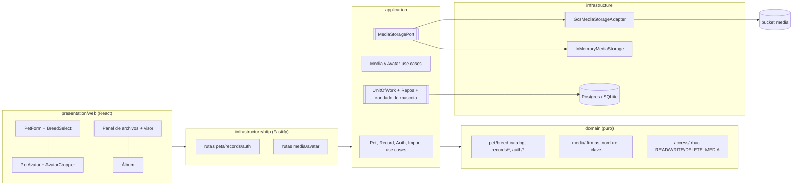

# Implementation Plan: Catálogos, registros y archivos (Feature 004, 4A-1 y 4A-2)

**Estado**: `DRAFT` (para aprobación de Neo, Nivel 2). Sin `APPROVED` ni `LOCKED`. **Decisiones D-01..D-20 firmadas por Neo el 2026-11-17 y asentadas** (ver «Decisiones de Neo asentadas» en `spec.md`). Fuentes: `spec.md`, `data-model.md`, `contracts/README.md`. **Enmienda única 2026-11-17**: integra los hallazgos de `/maggie`, `/mifune`, `/rama` y `/lock`; los 14 ADR originales se fusionaron en 5 (`K-14`).
**Alcance**: solo 4A-1 y 4A-2. No incluye 4B, 4C (avatares de la 008 consumen `breedCode`), 4D ni las decisiones 4, 5 y 6.

## 1. Arquitectura (hexagonal, sin cambiar el sentido de las dependencias)

Flujo de subida (`REQ-GCS-006`): navegador → `POST /pets/{petId}/media` (cuerpo crudo con `kind` en la query y `X-Argos-Filename`, `D-18` A; 10 MiB, lectura en streaming con corte) → ruta valida CSRF/sesión → caso de uso: permiso (`WRITE_MEDIA`), firma (`domain/media`), cuota previa → **T1**: `INSERT media_deletion_queue (clave, 'INTENT')` → `MediaStoragePort.put` → **T2** (candado de propietario y mascota, permiso y cuota re-verificados): `INSERT pet_media` + auditoría `PET_MEDIA` + `DELETE` de la fila `INTENT` → 201. Cualquier fallo después del `put` cambia la fila a `DELETE` y borra de inmediato.
Flujo de lectura: navegador → `GET …/access` (permiso `READ_MEDIA`) → `createReadUrl` (V4, host virtual, un solo TTL) → navegador carga `` (con `loading="lazy"` en el álbum) o `<iframe>` directamente de `https://<bucket>.storage.googleapis.com/…`; el visor renueva al 80 % de `expiresAt`.
Flujo de borrado de registro clínico (`D-11` A): una transacción con candado de mascota (guarda `SUPERSEDED`, `DELETE` físico con filas afectadas, auditoría `DELETE`) → 204; sin cola ni retención.
Flujo de borrado de medios: transacción con candado (`INSERT media_deletion_queue 'DELETE'` + `DELETE`) → `COMMIT` → `MediaStoragePort.delete` idempotente → `DELETE` de la cola; el mantenimiento diario reintenta sin tope, convierte `INTENT` vencidas y concilia `pets/`.
Flujo de edición (`D-16` A): `PATCH` con `If-Match` → transacción con candado → comparación de `revision` (409 `ERR-REC-CONFLICT` si difiere) → `UPDATE … revision + 1` + auditoría.
Flujo de avatar: `PUT` (cuerpo crudo JPEG/PNG/WebP ≤ 512 KiB) → `INTENT` → `put` en `pets/{petId}/avatar/{uuid}` → transacción con candado: `avatar_version + 1`, `avatar_object_id`, cola del anterior → `GET ?v=` por proxy autenticado.

## 2. Decisiones de arquitectura (ADR)

Equivalencias con la numeración anterior: ADR-004-01 = antiguos 01, 02, 03, 13, 14 · ADR-004-02 = antiguos 04, 05 (más intención previa y conciliación) · ADR-004-03 = antiguos 06, 10, 11, 12 · ADR-004-04 = antiguos 07, 08, 09 · ADR-004-05 = nuevo (concurrencia).

### ADR-004-01 — Medios: subida por el servidor, lectura por URL firmada, avatar por proxy y puerto con dos adaptadores
**Subida.** El servidor recibe el cuerpo (límite de 10 MiB, bajo el tope de 32 MiB de Cloud Run, con lectura en streaming que corta al exceder, y como máximo `ARGOS_MEDIA_MAX_CONCURRENT_UPLOADS` simultáneas) y lo escribe a GCS. **Transporte (`D-18` A)**: cuerpo crudo con `kind` en la query y nombre en `X-Argos-Filename` (`addContentTypeParser` de Fastify): cero dependencias y el mismo estilo que el avatar; `multipart/form-data` queda descartado. **Descartado**: URL firmada de subida (el servidor nunca vería los bytes y habría que validar después con riesgo de ventana). **Costo**: el contenido atraviesa Cloud Run (egreso interno gratuito; dentro del cupo de CPU).
**Lectura.** `GET` firmado V4 con un único TTL (`ARGOS_MEDIA_SIGNED_URL_TTL_SECONDS`, 30–900, por defecto 300) en `https://<bucket>.storage.googleapis.com` (origen propio del bucket, sin cookies de Argos). La firma usa la cuenta de ejecución con `iam.serviceAccounts.signBlob` (`serviceAccountTokenCreator` sobre sí misma); **no** se crean llaves de cuenta de servicio (REQ-SEC de la 003). `response-content-type` y `response-content-disposition` se firman: el navegador no puede reinterpretar el tipo; todo medio se sirve `inline` (`D-06` C) y el nombre en la URL es neutro (`D-14` A: `foto.jpg`, `archivo.pdf`). SVG/HTML nunca se aceptan, por lo que no existe un tipo activo servible. **Riesgo residual**: una URL válida puede reenviarse durante <= 900 s (`EDGE-010`, `RR-04`). El visor de PDF en `<iframe>` no expone errores de carga: se renueva de forma proactiva y en móvil se ofrece «Abrir o descargar».
**Avatar.** Una lista de mascotas muestra N avatares; firmar N URLs por `signBlob` es una llamada de red cada una. `GET /pets/{petId}/avatar?v={avatarVersion}` autentica por cookie, lee el objeto (≤ 512 KiB) y responde con caché inmutable solo si `v` coincide con la versión actual (`no-cache` en otro caso, `Vary: Cookie`). La clave lleva un UUID por versión (`pets/{petId}/avatar/{uuid}`) y `avatar_version` es una columna que nunca se reinicia: así el reintento de la cola jamás borra un avatar nuevo y la caché de un año no sirve una foto retirada. **Descartado**: URL firmada por avatar (latencia y cuota de `signBlob`), objeto público (rompe `public_access_prevention`).
**Puerto y adaptadores.** `MediaStoragePort` (`put`, `get`, `delete` idempotente, `list`, `createReadUrl`) con adaptador GCS (producción) y de memoria (desarrollo, E2E y pruebas; ruta `/__dev/media/…` solo fuera de producción). Sin `deletePrefix` ni `exists` (la cola es por clave y la conciliación usa `list`) y sin adaptador de disco (`K-03`). La batería de conformidad corre contra ambos. **Limitación asumida**: el E2E con el adaptador de memoria no ejercita la CSP ni el origen cruzado reales; se cubre con el humo contra el bucket real de T597 (`PE-06`).
**Dependencia (Nivel 2, `D-01` A, firmada).** `@google-cloud/storage` oficial, versión exacta, aislada en un único adaptador y con **auditoría previa de `/merovingian` del árbol transitivo (T612) como requisito previo de T567**. Descartado: REST propio con token de metadatos e `iamcredentials.signBlob` (B). Con `D-18` A no hay segunda dependencia.
**Decisiones de cierre de US4 (confirmadas por `/architect`, sin cambio de requisitos; Oracle `H-O-004US4-1` y `H-O-004US4-2`, `.specify/memory/audits/oracle-004-US4.md`).**
- **Políglota (EDGE-004, `SC-ALM-004`).** `INV-ARC-002` rechaza solo el marcado al inicio (tras BOM y espacios, ventana de 2048 bytes). Un JPEG con `<script>` al final se acepta por firma: se sirve `inline` con `response-content-type` fijado por la firma detectada y desde otro origen (`<bucket>.storage.googleapis.com`), así que el script final es dato inerte. **Riesgo residual (`H-O-004US4-1`)**: en GCS no se puede fijar `X-Content-Type-Options: nosniff` en una URL firmada; `nosniff` solo queda garantizado en la ruta de desarrollo `/__dev/media`. La defensa en producción es tipo y disposición firmados + origen aislado sin cookies + CSP (`img-src`/`frame-src`). Riesgo aceptado, de severidad menor; trazas `INV-ARC-002`, `INV-ARC-004`, `SC-ALM-012`.
- **Nombre canónico, tope (`SC-ALM-028`).** `canonicalMediaName` limita el nombre a 120 puntos de código **incluida la extensión** (`room = 120 - len(ext)`, truncado por puntos de código sin partir pares sustitutos), para respetar el máximo 1..120 de `MediaItem.originalName`.
- **Nombre vacío (`SC-ALM-028`).** Un nombre que queda solo con puntos o espacios (Unicode incluido), o vacío tras quitar la extensión o truncar, vale `archivo`: `../` da `archivo.<ext canónica>` y `.pdf` da `archivo.pdf`.
Trazas: REQ-ARC-001, REQ-ARC-003, REQ-AVA-001, REQ-GCS-002, REQ-GCS-003, INV-ARC-001, INV-ARC-004, INV-AVA-001, NFR-ALM-003, NFR-ALM-004.

### ADR-004-02 — Ciclo de vida del borrado: cola transaccional con intención previa, conciliación y borrado físico
**Contexto**: el borrado en GCS no participa de la transacción de la base de datos y `REQ-ACC-002` borra en cascada. **Decisión (outbox)**: dentro de la transacción se escriben las claves en `media_deletion_queue` (`reason = 'DELETE'`); tras el `COMMIT` se borra en GCS (idempotente) y se quita la fila; el mantenimiento diario reintenta **sin tope de intentos** y alerta a Neo cuando una fila supere 48 h. **Intención previa**: la subida inserta la clave con `reason = 'INTENT'` antes del `put` y la retira en la transacción que inserta la fila; una `INTENT` de más de 1 h se trata como `DELETE`, de modo que un corte del proceso entre el `put` y el `INSERT` no deja un objeto sin dueño. **Conciliación diaria**: `list('pets/')` y encolado de todo objeto de más de 24 h que no esté en `pet_media` (derivada), `pets.avatar_object_id` ni la cola. Tras eliminar una mascota o cuenta se lista además `pets/{petId}/` como refuerzo. El bucket con `soft_delete_policy = 0s` y sin versionado hace el borrado definitivo. **Garantía**: si la transacción revierte, la cola revierte; si GCS falla, la clave queda en la cola y no se pierde. **Descartado**: borrar GCS antes del `COMMIT` (un rollback dejaría filas sin objeto) y barrer por prefijo sin cola (carrera con subidas en vuelo, sin evidencia de pendientes; `K-06`).
**Borrado físico de registros (`D-11` A, `D-03` C)**: el borrado de un registro clínico es un `DELETE` físico dentro de una transacción con candado de mascota, con la guarda `SUPERSEDED` y la auditoría `DELETE` (`REQ-AUD-001`) en la misma transacción; no hay `deleted_at`, `deleted_by_user_id`, índices de purga, retención ni purga diferida (retención 0). **La cola `media_deletion_queue` se mantiene solo porque el borrado de objetos de GCS no participa de la transacción de base de datos** y necesita reintento (y la intención previa de la subida); no hay cola para registros. La ventana real de borrado de bytes es la de `REQ-PG-011`. **Descartado**: borrado lógico con retención de 30 o 7 días (`D-03` A/B: ventana total de ~44 o ~21 días sin restauración que la justifique), tabla de tombstones y retención indefinida. **Despliegue**: migraciones aditivas; el retroceso de imagen no resucita datos (`NFR-ALM-005`).
Trazas: REQ-BOR-001, REQ-BOR-004, REQ-GCS-004, REQ-GCS-006, REQ-IMP-001, INV-REG-001, INV-GCS-002, NFR-ALM-005.

### ADR-004-03 — Dominio: catálogo compilado, síntomas como categoría, firmas propias y recorte en el cliente
**Catálogo.** `contracts/catalogs/breeds.catalog.json` se compila a `src/generated/catalogs/` (cliente y servidor leen el mismo dato; cero rutas, cero tablas); `compile-contracts.sh` valida prefijo, unicidad y patrón (`SC-CAT-032`). La mascota guarda `breedCode` y `breed` derivado (rótulo; texto libre con `*_OTHER`), sin `breedOther` (`K-08`), de modo que respaldos, filtros y la 008 leen `breed` sin conocer el catálogo y pueden mapear por `breedCode`. Mascotas antiguas: `breedCode = null`. La raza no alimenta reglas clínicas (`INV-RAZ-002`). **Descartado**: tabla `breeds` (migraciones por cada ajuste, sin beneficio con 68 filas) y reemplazar `breed` por el código (rompe respaldos y lecturas).
**Síntomas.** Categoría `SYMPTOM` de `custom-parameters` con `symptomType` y `severity`; se reutilizan colección, permisos, auditoría, respaldo y exportación. Sin efectos clínicos ni de presentación por intensidad (`INV-SIN-002`); aviso y derivación fijos. **Descartado**: séptima colección clínica (alteraría `REQ-ACC-002` «6 colecciones», la matriz RBAC, el respaldo, las 6 tablas y el cascade, con el mismo resultado funcional).
**Firmas.** Tabla de firmas y comprobaciones en `src/domain/media/` (JPEG, PNG, WebP y PDF; `D-06` C: DOCX, XLSX y TXT quedan como `TECHDEBT-004-01`, sin inspección de ZIP). Sin lector de encabezado WebP ni validación de dimensiones del avatar (`K-09`). Cero dependencias, pura y comprobable con mutación. **Descartado**: `file-type` u otra librería (árbol de dependencias de Nivel 2 para ~200 líneas deterministas).
**Recorte.** El cliente dibuja en `canvas`, exporta un cuadrado 512×512 (WebP o, si el navegador no lo codifica, JPEG) y lo sube; el servidor solo valida firma y tamaño. La «circularidad» es una máscara de presentación, no un recorte del archivo. **Descartado**: procesar imagen en servidor (dependencia nativa como `sharp`).
Trazas: REQ-RAZ-001..003, REQ-SIN-001..003, REQ-AVA-002, INV-RAZ-001, INV-RAZ-002, INV-SIN-002, INV-ARC-001, INV-ARC-002, NFR-ALM-003.

### ADR-004-04 — Identidad: login por correo con cuenta única, `username` con mayúsculas y microchip global
**Login.** Si el identificador contiene `@`, se busca por `LOWER(email)` tras recortar y normalizar con una única función de dominio; con exactamente una cuenta se verifica su contraseña; con cero o varias, se verifica contra un hash ficticio y se devuelve el error genérico (una sola verificación de hash en los 4 casos). El límite de intentos acumula por identificador normalizado y por cuenta resuelta. No se crea unicidad del correo. **Costo**: quien comparte correo entre cuentas entra por `username`. **Descartado (D-04 B)**: volver único el correo (filtra la existencia al registrar y exige limpiar datos).
**`username`.** Patrón `^[A-Za-z0-9._-]+$`; índice único sobre `LOWER(username)`; el inicio de sesión y las invitaciones comparan con `LOWER`. Revierte H-F5-08; recupera `INV-AUTH-001` de la 001. No se normaliza el valor guardado.
**Microchip.** `pets_microchip_global` (índice único parcial). El caso de uso mapea solo la violación de esa restricción por nombre, sin consulta previa por propietario (misma ruta para duplicado propio y ajeno), descarta el objeto de error del driver y devuelve el mismo `ERR-PET-MICROCHIP-DUPLICATE`; el cuerpo, los logs y la auditoría no incluyen el microchip ni IDs. Patrones triviales rechazados (patrón `MicrochipInput` corregido y validación de dominio), límite de duplicados y canal de resolución por Neo (`REQ-PET4-002`). **Límite de duplicados (aprobado por Neo, T556/T557)**: `ERR-RATE-LIMITED` aprobado (ya no es pendiente); ventana deslizante de 24 h (`MICROCHIP_DUPLICATE_WINDOW_MINUTES=1440`) con tope `MICROCHIP_DUPLICATE_MAX_PER_WINDOW=5` por usuario en `app-config.ts`; **orden de validación 404/403 → 422 → 429** (el chequeo de cuota va después de la autorización y de la validación de esquema); **chequeo previo** a cualquier guardado con `microchipId` no nulo (con 5 o más eventos en la ventana responde 429 sin guardar, sea el chip nuevo o existente, para no crear un oráculo de existencia); el evento se registra solo al ocurrir un duplicado, en una transacción independiente y best effort (sin loguear identificador ni microchip); alcance: alta, edición (solo si cambia `microchipId`) e importación de respaldo (un duplicado cuenta uno). **Almacenamiento**: nuevo ámbito `MICROCHIP_DUPLICATE` en `rate_limit_events`; migraciones de Nivel 2 autorizadas por Neo, SQLite `0010_rate_limit_microchip_scope.sql` y PostgreSQL `0006_rate_limit_microchip_scope.sql` (`0009`/`0005` quedan intactas para medios). **Descartado**: día calendario `America/Bogota` (ráfaga doble en la medianoche) y conteo solo al duplicar (el 429 delataría qué chips existen). **Riesgo residual (aceptado, `RR-06`)**: la respuesta confirma que el microchip existe.
Trazas: REQ-LOG-001, REQ-LOG-002, REQ-PET4-001, REQ-PET4-002, INV-LOG-001, INV-LOG-002, INV-PET4-001, NFR-ALM-002.

### ADR-004-05 — Consistencia concurrente: candado de mascota y de propietario
**Contexto**: ningún criterio de la versión inicial ejercitaba concurrencia y el estado se decidía entre GCS y varias transacciones. **Decisión**: toda transacción que cree, edite, borre o supersede registros, suba o borre medios, cambie el avatar o elimine la mascota toma primero el candado de la mascota (`SELECT … FOR UPDATE` en Postgres, `BEGIN IMMEDIATE` en SQLite) y, si valida cuota, antes el del propietario (orden usuario → mascota, sin ciclos). El borrado físico comprueba filas afectadas; la guarda `SUPERSEDED` se evalúa dentro de la transacción. `avatar_version` y `avatar_object_id` son columnas, no parte del JSON de la mascota, para que un `PATCH` no los revierta. **Revisión (`D-16` A)**: columna `revision` por registro; el `PATCH` exige `If-Match`, se compara bajo el candado y un desfase da 409 `ERR-REC-CONFLICT`; `revision` solo aumenta con ediciones efectivas. **Descartado**: serializar toda la base (innecesario para <= 3 usuarios) y optimismo sin candado en la cuota (TOCTOU).
Trazas: REQ-BOR-005, REQ-ARC-005, INV-REG-003, INV-AVA-001, INV-GCS-002.

## 3. Terraform y configuración

- `terraform/buckets_media.tf`: bucket `media` (REQ-GCS-001). `buckets.tf` (`exports`) **no se toca**. Los Data Access logs del bucket de medios no se activan.
- `terraform/iam.tf`: `google_storage_bucket_iam_member` `roles/storage.objectUser` para `argos-run@` solo sobre `media`; `google_service_account_iam_member` `roles/iam.serviceAccountTokenCreator` de `argos-run@` sobre sí misma (REQ-GCS-002). La API `iamcredentials.googleapis.com` se añade a `services.tf`.
- Cloud Run: variables `ARGOS_MEDIA_DRIVER=gcs`, `ARGOS_MEDIA_BUCKET`, `ARGOS_MEDIA_SIGNED_URL_TTL_SECONDS=300`, `ARGOS_MEDIA_MAX_BYTES=10485760`, `ARGOS_MEDIA_MAX_BYTES_PER_OWNER=1073741824`, `ARGOS_MEDIA_MAX_CONCURRENT_UPLOADS=4` (sin variable de retención: `D-03` C): valores en el `cloud_run.tf`; nada secreto. Memoria del servicio dimensionada para 4 subidas de 10 MiB (E3-05).
- CSP: `img-src` y `frame-src` con el host `<bucket>.storage.googleapis.com` (E3-03; `D-19` A: sin `https:`; `avatarUrl` solo como enlace de texto).

## 4. Riesgos y mitigaciones

| Riesgo | Mitigación | ID |
|---|---|---|
| Polígloto o archivo activo servido en línea | Lista cerrada por firma, rechazo de SVG/HTML por sondeo, `response-content-type` firmado, host de bucket aislado, CSP, nombre de descarga con extensión canónica | INV-ARC-001/002, SC-ALM-004, SC-ALM-028 |
| Objeto huérfano tras fallo parcial, corte del proceso o carrera con la eliminación | Intención previa + outbox + conciliación + candado de mascota + invariante de conjunto | INV-GCS-002, SC-ALM-025, SC-ALM-026, SC-ALM-031 |
| Datos antiguos chocan con índices nuevos (`LOWER(username)`, microchip) | Comprobaciones previas que abortan sin cambios | SC-CAT-025 |
| Doble envío o carrera del avatar; caché inmutable de una foto retirada | `avatar_version` monótono en columna, UUID por versión, `?v` contrastado | SC-ALM-016, SC-ALM-027 |
| iPhone/Safari no produce WebP | Exportación JPEG y avatar JPEG/PNG/WebP; prueba en WebKit y dispositivo real | SC-ALM-019, PE-04 |
| Cuota de `signBlob` en el álbum (24 firmas por página) | Una firma por elemento solo al pedir `/access`; el listado no firma. Si se mide presión, TECHDEBT con caché de 60 s | REQ-ALB-001 |
| Costo fuera de 0 USD (almacenamiento, salida de red, operaciones) | Cuota en bytes, `terraform plan` sin recursos de pago, sin LB/CDN, alerta de presupuesto (E3-05), métrica de bytes servidos | NFR-ALM-001 |
| Cambio de `username` rompe invitaciones existentes | Búsqueda por `LOWER`; las invitaciones abiertas siguen válidas | SC-CAT-021 |
| Corte entre `main` y la 002 | Delta aplicado en el texto de 002 y 003 (D-10); contratos máquina de la 002 en T510..T512 y regeneración en T515 (la prueba de deriva de contratos no se rompe editándolos en un solo paso) | D-10 |
| Retroceso de imagen tras la migración | Migraciones aditivas y sin borrado lógico: el código anterior las ignora; solo se pierde el control de revisión | NFR-ALM-005, SC-ALM-033 |
| EXIF y GPS en las fotos | Reexportación por `canvas` en el cliente (garantía de la interfaz, no de la API) | SC-ALM-035 |
| Ediciones simultáneas del mismo registro | `revision` + `If-Match` + 409 `ERR-REC-CONFLICT` | SC-CAT-035 |
| Imágenes completas pesadas en el álbum | `loading="lazy"`, página de 24, riesgo aceptado con disparador (`D-20` B) | TECHDEBT-004-04 |
| Fuga de nombre, clave, firma o microchip en logs | Redacción por campo y por forma; pruebas de fallo del SDK, de la subida y de Postgres | NFR-ALM-002, SC-ALM-024 |
| Texto clínico que parezca diagnóstico o semáforo | Sin color por intensidad, aviso y derivación fijos, sin interpretación de texto libre; validación veterinaria externa | INV-SIN-002, SC-CAT-034, PE-01 |

## 5. Orden de trabajo y compuertas

1. Phase 1 (T501..T509, T598, T612): decisiones de Neo (D-01..D-20, firmadas y asentadas), `/merovingian` (grafo de impacto y auditoría de la dependencia, T612), `/maggie`, `/sati`, `/lock`, `/rama`, `/mifune` (las cuatro últimas ya ejecutadas y integradas), pendientes externos, `/mouse`.
2. Phase 2 (T510..T517): contratos (`/architect`), scripts (N2), compilación (`/keymaker`).
3. Phases 3..5 (4A-1) y 6..7 (4A-2) en TDD; migraciones numeradas en orden `0002` (PG) / `0006` (SQLite) antes que `0005` / `0009`.
4. Phase 8: seguridad, accesibilidad, costo, runbook, compuertas (`tsc`, `test:gate`, `verify-traceability --feature 004`, `verify-oracles`) y firma de Neo.

Cada commit de implementación pasa por `/oracle` (`MAX_RETRY = 1`). Ninguna tarea pasa de `REVIEW` sin la firma de Neo.
