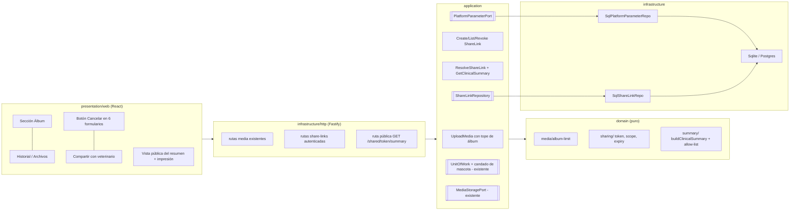

# Implementation Plan: Álbum, archivos clínicos, cancelar edición, enlace veterinario y ClinicalSummary (Feature 005, Fase 4B)

**Estado**: `DRAFT` (para aprobación de Neo, Nivel 2). Sin `APPROVED` ni `LOCKED`. Fuentes: `spec.md`, `claude/backlog-fase-4b.md` y, solo lectura, `specs/004-*/{spec,plan,data-model}.md` y `contracts/`.
**Alcance**: Fase 4B. No incluye 4C, 4D, UI de administración de plataforma ni integración de IA (Fase 5).
**Regla de contratos**: los contratos de 004 son `LOCKED`; cualquier cambio es la enmienda `D5-*` de `spec.md` y requiere firma de Neo antes de que `/architect` la aplique. Los contratos **nuevos** de 005 (`contracts/`) los crea T706 tras las decisiones; hoy el directorio no existe.

## 1. Arquitectura (hexagonal, mismo sentido de dependencias que 004)

### 1.1 Dominio (`src/domain/`, puro, sin `fs`, `fetch`, SDK ni `process.env`)
- `media/album-limit.ts`: `assertAlbumHasRoom(currentPhotoCount, maxPhotosPerPet)` lanza `ERR-MEDIA-ALBUM-LIMIT`. Cuenta solo `PHOTO`.
- `sharing/share-token.ts`: reglas puras de formato del token (43 caracteres base64url), `hashToken` recibe el digest por puerto (la generación aleatoria vive en infraestructura, `node:crypto`), `isExpired(link, now)`, `isRevoked`, `scope` cerrado `PET|HOUSEHOLD`.
- `summary/clinical-summary.ts`: `buildClinicalSummary(input, generatedAt)` pura y determinista; construye el objeto **por allow-list** (campo a campo, no por copia de objeto). Orden canónico de listas y claves; sin acceso a reloj.
- `parameters/platform-parameters.ts`: catálogo en código de claves conocidas con tipo, valor por defecto, mínimo y máximo (`album.max_photos_per_pet`: entero, defecto 10, rango 1..50).

### 1.2 Aplicación (`src/application/`)
- Puertos: `PlatformParameterPort.getInt(key)`, `ShareLinkRepository` (`create`, `findByHash`, `listByCreator`, `revoke`, `deleteByPet|Household|User`), `ClockPort` y `TokenGeneratorPort` (existentes o nuevos mínimos).
- Casos de uso: `UploadMedia` (existente) recibe la comprobación de tope **dentro de la transacción final** con el candado de mascota y antes del `put`; `CreateShareLink`, `ListShareLinks`, `RevokeShareLink`, `ResolveShareLink` (única entrada pública; devuelve el alcance o un `NotFound` uniforme) y `GetClinicalSummary(scope|petId)` que reúne los datos con los repos existentes y delega en el dominio.
- Autorización: creación y revocación con permiso a definir en `D5-10`; `ResolveShareLink` no usa sesión.

### 1.3 Adaptadores (`src/infrastructure/`)
- `SqlPlatformParameterRepository`, `SqlShareLinkRepository` (SQLite y Postgres con paridad), `CryptoTokenGenerator` (`randomBytes(32)`, base64url).
- Rutas autenticadas `POST|GET /pets/{petId}/share-links`, `POST|GET /households/{householdId}/share-links`, `DELETE /share-links/{id}` (con cookie + CSRF como el resto). Ruta pública `GET /shared/{token}/summary` fuera del grupo con sesión, con cabeceras de `REQ-VET-006` y el 404 uniforme; límite de tasa por IP en memoria `[D5-13]`.
- Reutiliza `MediaStoragePort` para URLs firmadas de archivos clínicos (`REQ-VET-009`).

### 1.4 Presentación (`src/presentation/web/`)
- «Álbum» y «Historial / Archivos» como secciones separadas que consumen los mismos endpoints con `kind=PHOTO` y `kind=FILE`.
- Botón «Cancelar» en los 6 formularios (componente compartido `FormActions`).
- Diálogo «Compartir con veterinario» (alcance, caducidad, copiar URL una sola vez, lista y revocación) y vista pública de solo lectura con estilos `@media print`. Prototipos de `/sati` (T705) previos a implementar.

### 1.5 Forma del `ClinicalSummary` (esquema cerrado, a formalizar en T706)
Campos de primer nivel: `summaryVersion` (`"1.0.0"`), `generatedAt`, `scope` (`PET|HOUSEHOLD`), `pets[]` (una por mascota del alcance) con `profile` (nombre, especie, raza, sexo, esterilizado, fecha de nacimiento y si es estimada, edad derivada con `generatedAt`), `weights[]`, `bodyMeasurements[]`, `vaccinations[]`, `dewormings[]`, `medicalVisits[]`, `symptoms[]`, `otherParameters[]`, `clinicalFiles[]` (id opaco, tipo MIME, tamaño, fecha, y nombre solo según `D5-06`). `additionalProperties: false` en todos los objetos; listas ordenadas `(fecha DESC, id DESC)`.

## 2. Modelo de datos (deltas; migraciones **Nivel 2**, SQLite y Postgres con prueba de paridad; los números de migración los asigna Keymaker tras la última de 004)

### 2.1 `platform_parameters` (REQ-PRM-001..003)

| Columna | Tipo | Restricción |
|---|---|---|
| `key` | `TEXT` | PK; patrón `^[a-z][a-z0-9_.]{2,63}$` validado por dominio |
| `value_type` | `TEXT` | NOT NULL, `CHECK (value_type IN ('INTEGER','TEXT','BOOLEAN'))` |
| `value` | `TEXT` | NOT NULL (texto canónico del valor; el tipo lo interpreta el dominio) |
| `min_value` / `max_value` | `INTEGER` | NULL permitido; límites informativos para la futura UI de administración |
| `description` | `TEXT` | NOT NULL (<= 200) |
| `updated_at` | `TEXT` | NOT NULL, ISO-8601 UTC |
| `updated_by_user_id` | `TEXT` | NULL; **sin FK** (el perfil de administrador de plataforma aún no existe, `REQ-PRM-003`) |

Siembra: `('album.max_photos_per_pet','INTEGER','10',1,50,'Máximo de fotos de álbum por mascota',now,NULL)`. Alternativa descartada: columnas por parámetro en una tabla ancha (cada parámetro nuevo exigiría migración). Alternativa descartada: JSON único (no se puede consultar ni restringir por clave).

### 2.2 `share_links` (REQ-VET-*)

| Columna | Tipo | Restricción |
|---|---|---|
| `id` | `TEXT` (UUID v4) | PK; es el identificador visible en listas y auditoría |
| `token_hash` | `TEXT` | NOT NULL, UNIQUE (hex de `SHA-256`) |
| `scope` | `TEXT` | NOT NULL, `CHECK (scope IN ('PET','HOUSEHOLD'))` |
| `pet_id` | `TEXT` | FK `pets(id)` `ON DELETE CASCADE`; NOT NULL si `scope = 'PET'` |
| `household_id` | `TEXT` | FK `households(id)` `ON DELETE CASCADE`; NOT NULL si `scope = 'HOUSEHOLD'` |
| `created_by_user_id` | `TEXT` | NOT NULL, FK `users(id)` `ON DELETE CASCADE` |
| `created_at` / `expires_at` | `TEXT` | NOT NULL, ISO-8601 UTC; `CHECK (expires_at > created_at)` |
| `revoked_at` | `TEXT` | NULL = activo |
| `include_microchip` | `INTEGER` | NOT NULL DEFAULT 0 (`D5-14`) |

`CHECK ((scope='PET' AND pet_id IS NOT NULL AND household_id IS NULL) OR (scope='HOUSEHOLD' AND household_id IS NOT NULL AND pet_id IS NULL))`. Índices: `share_links_created_by (created_by_user_id, created_at DESC)`, el único de `token_hash` sirve la resolución pública. Sin columna de token, sin IP.

### 2.3 Sin cambios en `pet_media`
El álbum y los archivos clínicos ya se distinguen por `kind`. El conteo del tope usa el índice `pet_media_pet_created (pet_id, kind, created_at DESC, id DESC)` de 004.

## 3. Decisiones de arquitectura (ADR)

### ADR-005-01 — Álbum = `PHOTO`, archivos clínicos = `FILE`; el tope es regla de aplicación, no de base de datos
- **Contexto**: 004 ya separa `kind` y `INV-ARC-001` permite imágenes y PDF en `FILE`. Un `CHECK` no puede acotar el conteo por mascota ni leer un parámetro.
- **Decisión**: la regla vive en `assertAlbumHasRoom` dentro de la transacción de subida con el candado de mascota de 004 (`REQ-BOR-005`), más una comprobación previa al `put`. Sin triggers.
- **Alternativas descartadas**: ampliar el enum `kind` con `CLINICAL_PHOTO` (cambia el contrato LOCKED sin necesidad); trigger de BD (acopla el tope al motor y rompe la paridad).
- **Consecuencia**: mascotas con más de 10 fotos de 004 no se tocan (`REQ-ALB5-003`). Exige `D5-01` y `D5-02`.

### ADR-005-02 — Parámetros de plataforma en tabla clave-valor tipada con valor por defecto en código
- **Contexto**: Neo pide un parámetro solo por código y BD, consultable con facilidad y asociable luego a un administrador de plataforma.
- **Decisión**: ver §2.1; el código declara claves, tipos, defecto y rango; la BD lo sobrescribe. Sin endpoint ni UI.
- **Alternativas descartadas**: variable de entorno (requiere redeploy, no es consultable por futuro admin); tabla ancha; archivo JSON.
- **Consecuencia**: una fila corrupta nunca bloquea la subida (se cae al defecto).

### ADR-005-03 — Enlace veterinario: token de capacidad opaco con hash en BD, ruta pública de solo lectura única
- **Contexto**: primera superficie sin sesión. Un identificador de mascota en la URL sería enumerable (IDOR).
- **Decisión**: token aleatorio de 256 bits, solo su `SHA-256` en BD, caducidad obligatoria, revocación inmediata, una única ruta `GET`, respuesta 404 uniforme, cabeceras `no-store`, `no-referrer`, `noindex`, CSP restrictiva, límite de tasa, auditoría sin secretos.
- **Alternativas descartadas**: JWT firmado (no revocable sin lista, dependencia de claves); identificador de mascota firmado con HMAC (no revocable, mismo problema); sesión temporal de «invitado» (introduce un tipo de usuario nuevo y CSRF/cookies en la superficie).
- **Consecuencia**: requiere gates de `/trinity` y `/rama` **antes** de implementar T750.

### ADR-005-04 — `ClinicalSummary` como read-model puro por allow-list, versionado y con esquema cerrado
- **Contexto**: la vista web, la impresión y la IA de Fase 5 deben leer el mismo dato sin divulgar de más.
- **Decisión**: función pura `buildClinicalSummary(datos, generatedAt)`; salida construida campo a campo; esquema JSON cerrado `clinical-summary.schema.json` con `summaryVersion`; calculado bajo demanda sin persistir.
- **Alternativas descartadas**: serializar entidades y quitar campos (deny-list: un campo nuevo se filtraría); persistir instantáneas (caduca, duplica datos clínicos); PDF en servidor (dependencia nueva, Nivel 2).
- **Consecuencia**: cualquier campo clínico nuevo exige tocar dominio, esquema y prueba.

### ADR-005-05 — «Cancelar» es comportamiento de cliente
- **Decisión**: un componente `FormActions` compartido con `Cancelar` y `Guardar`; sin endpoint ni cambio de contrato. Prueba de componente por formulario y prueba E2E de «sin petición de escritura».

## 4. Riesgos y mitigaciones

| Riesgo | Mitigación |
|---|---|
| Fuga del token por `Referer`, historial, proxy o reenvío | TTL acotado, revocación, `no-referrer`, token fuera de registros, aviso en la UI de que el enlace es una credencial |
| Enumeración / fuerza bruta del token | 256 bits, 404 uniforme, límite de tasa (`D5-13`) |
| Divulgar de más en el resumen (microchip, nombres, hogar) | allow-list, pruebas SC-005-029/030, `/rama` previo |
| Tope de fotos choca con 004 (`K-10`) | enmienda `D5-01` firmada antes de T720 |
| Sin límite por IP en el repositorio (RR-07 de 004) | límite en aplicación en memoria como mitigación mínima; Cloud Armor = decisión de Nivel 2 |
| Concurrencia de subidas con el tope | candado de mascota, prueba intercalada (SC-005-003) |
| Hogar dinámico expone más de lo esperado | resolver mascotas por asignación vigente en cada petición (`D5-05`) |
| Datos clínicos hacia IA | fuera de 005; Fase 5 exige `/rama` y aprobación de Neo antes de cualquier envío |

## 5. Compuertas previas obligatorias (orden)

1. **Neo**: decisiones `D5-01..D5-15` (T700).
2. **`/merovingian`**: impacto de las enmiendas sobre 004 (T701).
3. **`/rama` (privacidad)**: datos clínicos, exclusiones del resumen, enlace, registros y retención de auditoría de accesos (T702). **Bloquea** T750 y T770.
4. **`/trinity` (seguridad)**: modelo de amenazas de la superficie pública y suite de explotación diseñada **antes** de implementar (T703). **Bloquea** T750.
5. **`/maggie`**: contenido y orden clínico del resumen y de la sección de archivos (T704).
6. **`/sati`**: prototipos aprobados por Neo (T705).
7. **`/architect`**: contratos de 005 (T706), luego **`/mifune`** y **`/lock`** (T707), luego **`/mouse`** como compuerta estructural única (T708). **Ningún código de `src/` antes de T708 y de contratos compilados.**
8. Tras la implementación: `/oracle` por lote, `/trinity` y `/rama` posteriores (T790..T793).

## 6. Orden de trabajo
Fase 1 (gobernanza, T700..T709) -> Fase 2 (parámetros, T710..T714) -> US1 álbum (T720..T727) en paralelo con US2 archivos (T730..T735) y US3 cancelar (T740..T744) -> US4 enlace (T750..T765) -> US5 resumen (T770..T778; el dominio de T770..T774 se implementa **antes** de T758 porque el enlace lo consume) -> cierre (T790..T796).
