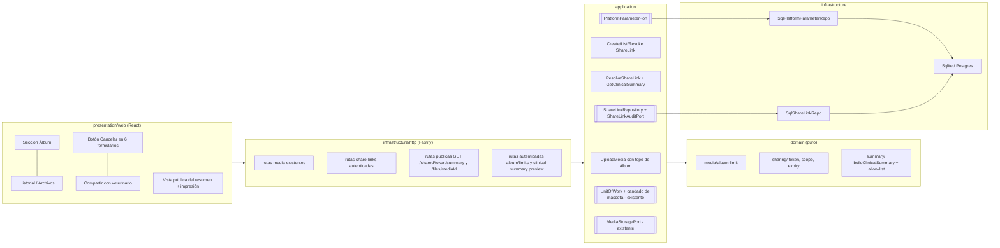

# Implementation Plan: Álbum, archivos clínicos, cancelar edición, enlace veterinario y ClinicalSummary (Feature 005, Fase 4B)

**Estado**: `DRAFT` (para aprobación de Neo, Nivel 2; revisión T706 del 2026-11-18 con las decisiones D5-16..D5-24). Sin `APPROVED` ni `LOCKED`. Fuentes: `spec.md`, `data-model.md`, `contracts/`, los informes de gate de T701..T705 en `.specify/memory/audits/` y, solo lectura, `specs/004-*/{spec,plan,data-model}.md` y `contracts/`.
**Alcance**: Fase 4B. No incluye 4C, 4D, UI de administración de plataforma ni integración de IA (Fase 5).
**Regla de contratos**: los contratos de 004 son `LOCKED`; cualquier cambio es la enmienda `D5-*` de `spec.md` y requiere firma de Neo antes de que `/architect` la aplique. Los contratos **nuevos** de 005 (`contracts/`) los creó T706 (incrementales: esquemas, OpenAPI `3.3.0`, catálogo de errores y máquina `STATE-SHARE-001`); las enmiendas de texto de 004 y 002 firmadas por Neo (D5-01, D5-02, D5-10) también se aplicaron en T706, sin tocar los contratos máquina.

## 1. Arquitectura (hexagonal, mismo sentido de dependencias que 004)

### 1.1 Dominio (`src/domain/`, puro, sin `fs`, `fetch`, SDK ni `process.env`)
- `media/album-limit.ts`: `assertAlbumHasRoom(currentPhotoCount, maxPhotosPerPet)` lanza `ERR-MEDIA-ALBUM-LIMIT`. Cuenta solo `PHOTO`.
- `sharing/share-token.ts`: reglas puras de formato del token (43 caracteres base64url; solo para generación, la ruta pública no lo valida en el borde), `hashToken` recibe el digest por puerto (la generación aleatoria vive en infraestructura, `node:crypto`), `deriveStatus(link, now)` (`STATE-SHARE-001`: REVOKED > EXPIRED > ACTIVE), `scope` cerrado `PET|HOUSEHOLD`, `hasShareAuthority` (PET: rol efectivo; HOUSEHOLD: rol en el hogar y propiedad legal) y el tope de 20 activos.
- `summary/clinical-summary.ts`: `buildClinicalSummary(input, generatedAt, {includeMicrochip, includeClinicalFiles})` pura y determinista; construye el objeto **por allow-list** (campo a campo, no por copia de objeto). Orden canónico de listas y claves; fechas de calendario sin conversión; sin acceso a reloj, sin interpretación automática y sin nombres de archivo.
- `parameters/platform-parameters.ts`: catálogo en código de claves conocidas con tipo, valor por defecto, mínimo y máximo (`album.max_photos_per_pet`: entero, defecto 10, rango 1..50).

### 1.2 Aplicación (`src/application/`)
- Puertos: `PlatformParameterPort.getInt(key)`, `MediaRepository.countByPetAndKind` (nuevo en ambos motores), `ShareLinkRepository` (`create`, `findByHash`, `listByScope`, `countActive`, `revoke`, `purgeExpired`), `ShareLinkAuditPort` (eventos y fallos agregados por HMAC de IP), `ClockPort` y `TokenGeneratorPort` (existentes o nuevos mínimos).
- Casos de uso: `UploadMedia` (existente) recibe la comprobación de tope **dentro de la transacción final** con el candado de mascota y antes del `put`; `CreateShareLink`, `ListShareLinks`, `RevokeShareLink`, `ResolveShareLink` (única entrada pública; devuelve el alcance o un `NotFound` uniforme) y `GetSharedSummaryView(scope)` que reúne los datos con los repos existentes en **una transacción de lectura**, delega en el dominio y arma `SharedSummaryView` (`fileLabels` desde `pet_media.original_name` solo de los archivos autorizados), `GetSharedFile` (re-resuelve el token, valida `mediaId` y emite la URL firmada) y `PreviewClinicalSummary` autenticado.
- Autorización: `CREATE_SHARE_LINK` (`rbac.ts`: `OWNER`, `ADMIN`); `PET` por rol efectivo, `HOUSEHOLD` por rol del usuario en el hogar (B3); la revocación admite al creador, al propietario legal y al propietario o `ADMIN` del hogar; `ResolveShareLink` no usa sesión y revalida la autoridad del creador en cada acceso (`D5-17`).

### 1.3 Adaptadores (`src/infrastructure/`)
- `SqlPlatformParameterRepository`, `SqlShareLinkRepository` (SQLite y Postgres con paridad), `CryptoTokenGenerator` (`randomBytes(32)`, base64url).
- Rutas autenticadas `GET /pets/{petId}/album/limits`, `POST|GET /pets/{petId}/share-links`, `POST|GET /households/{householdId}/share-links`, `DELETE /share-links/{id}` (revoca), `GET /pets/{petId}/clinical-summary` y `GET /households/{householdId}/clinical-summary` (vista previa), con cookie + CSRF como el resto. Rutas públicas `GET /shared/{token}/summary` y `GET /shared/{token}/files/{mediaId}` (302) fuera del grupo con sesión, con las cabeceras de `REQ-VET-006` en toda respuesta, el 404 uniforme (`instance` constante `/shared`), el serializer de registros sin URL y el límite de tasa por IP en memoria `[D5-13]`; todo otro verbo bajo `/shared/**` responde el mismo 404. La página `/shared/{token}` es la SPA sin datos.
- Reutiliza `MediaStoragePort` para URLs firmadas de archivos clínicos con TTL duro de 300 s (`REQ-VET-009`, `INV-005-008`).
- Mantenimiento diario existente (`REQ-CLD-007`): purga de enlaces vencidos o revocados (30 días) y de la auditoría (90 días).

### 1.4 Presentación (`src/presentation/web/`)
- «Álbum» y «Historial / Archivos» como secciones separadas que consumen los mismos endpoints con `kind=PHOTO` y `kind=FILE`.
- Botón «Cancelar» en los 6 formularios (componente compartido `FormActions`).
- Diálogo «Compartir con veterinario» (alcance, caducidad, copiar URL una sola vez, lista y revocación) y vista pública de solo lectura con estilos `@media print`. Prototipos de `/sati` (T705) previos a implementar.

### 1.5 Forma del `ClinicalSummary` y del `SharedSummaryView` (formalizados en `contracts/schemas/`)
`ClinicalSummary` (esquema cerrado, `clinical-summary.schema.json`): `summaryVersion` (`"1.0.0"`), `generatedAt`, `scope` (`PET|HOUSEHOLD`), `dataProvenance`, `automaticInterpretation`, `disclosure {microchipIncluded, clinicalFilesIncluded}` y `pets[]` (una por mascota del alcance) con `profile` (nombre, especie, raza, sexo, esterilizado, fecha de nacimiento y si es estimada, edad derivada con `generatedAt`; microchip solo con `D5-14`), `weights[]`, `bodyMeasurements[]`, `vaccinations[]`, `dewormings[]`, `medicalVisits[]`, `symptoms[]`, `otherParameters[]` y `clinicalFiles[]` = `{id, mime, sizeBytes, createdAt}` **sin nombre** (corrige la redacción anterior «nombre solo según D5-06», que contradecía `REQ-SUM-003`, RAMA-005-003 y B1). `additionalProperties: false` en todos los objetos; listas ordenadas `(fecha DESC, id interno DESC)`; fechas de calendario `YYYY-MM-DD` sin UTC.

`SharedSummaryView` (`share-link.schema.json`) = `{summary: ClinicalSummary, fileLabels: [{fileId, displayName}], validUntil}`: **canal contractual del nombre original (B1)**. El nombre se lee de `pet_media.original_name` tras resolver el token, solo de los archivos autorizados, y se escapa en la SPA; nunca entra en el read-model, la URL, las cabeceras ni los registros.

## 2. Modelo de datos (deltas; migraciones **Nivel 2**, SQLite y Postgres con prueba de paridad)

El detalle vive en `data-model.md` (los números de migración los asigna Keymaker tras la última de 004): `platform_parameters` (§2 de ese archivo; siembra `album.max_photos_per_pet = 10`, rango 1..50, TTL de caché <= 60 s), `share_links` (§3: `expires_in_days` ∈ {1,7,30}, `include_microchip`, `include_clinical_files`, sin columna de estado, sin token, cascada por mascota, hogar y usuario, tope de 20 activos bajo candado), `share_link_audit` (§4: HMAC de IP con clave dedicada, fallos agregados, retención 90 días) y el puerto `countByPetAndKind` sobre `pet_media` sin cambio de esquema (§1). `share_links`, `share_link_audit` y `platform_parameters` quedan fuera del respaldo exportable (§5). Alternativas descartadas para parámetros: tabla ancha (cada parámetro exigiría migración) y JSON único (no consultable ni restringible por clave).

## 3. Decisiones de arquitectura (ADR)

### ADR-005-01 — Álbum = `PHOTO`, archivos clínicos = `FILE`; el tope es regla de aplicación, no de base de datos
- **Contexto**: 004 ya separa `kind` y `INV-ARC-001` permite imágenes y PDF en `FILE`. Un `CHECK` no puede acotar el conteo por mascota ni leer un parámetro.
- **Decisión**: la regla vive en `assertAlbumHasRoom` dentro de la transacción de subida con el candado de mascota de 004 (`REQ-BOR-005`), con el conteo **después** del candado y repetido en PostgreSQL, más una comprobación previa al `put`; el valor vigente se expone por `getAlbumLimits` (B-1 de `/sati`). Sin triggers.
- **Alternativas descartadas**: ampliar el enum `kind` con `CLINICAL_PHOTO` (cambia el contrato LOCKED sin necesidad); trigger de BD (acopla el tope al motor y rompe la paridad).
- **Consecuencia**: mascotas con más de 10 fotos de 004 no se tocan (`REQ-ALB5-003`). Exige `D5-01` y `D5-02`.

### ADR-005-02 — Parámetros de plataforma en tabla clave-valor tipada con valor por defecto en código
- **Contexto**: Neo pide un parámetro solo por código y BD, consultable con facilidad y asociable luego a un administrador de plataforma.
- **Decisión**: ver §2.1; el código declara claves, tipos, defecto y rango; la BD lo sobrescribe. Sin endpoint ni UI.
- **Alternativas descartadas**: variable de entorno (requiere redeploy, no es consultable por futuro admin); tabla ancha; archivo JSON.
- **Consecuencia**: una fila corrupta nunca bloquea la subida (se cae al defecto).

### ADR-005-03 — Enlace veterinario: token de capacidad opaco con hash en BD, ruta pública de solo lectura única
- **Contexto**: primera superficie sin sesión. Un identificador de mascota en la URL sería enumerable (IDOR).
- **Decisión**: token aleatorio de 256 bits **en la ruta** (D5-16, con instance constante, serializer sin URL, `no-referrer`, `no-store`, TTL <= 30 días y filtro de Cloud Logging de `/link`), solo su `SHA-256` en BD, caducidad obligatoria {1,7,30}, revocación inmediata (marca, no borra), autoridad del creador revalidada en cada acceso (D5-17), tope de 20 activos (D5-18), alcance `HOUSEHOLD` limitado a mascotas propias del creador (D5-19), dos rutas `GET` de lectura (resumen y archivo), 404 uniforme también para token mal formado y cabeceras en 404 y 429, límite de tasa, auditoría sin secretos con retención 90/30 días (D5-20).
- **Alternativas descartadas**: JWT firmado (no revocable sin lista, dependencia de claves); identificador de mascota firmado con HMAC (no revocable, mismo problema); sesión temporal de «invitado» (introduce un tipo de usuario nuevo y CSRF/cookies en la superficie).
- **Consecuencia**: requiere gates de `/trinity` y `/rama` **antes** de implementar T750.

### ADR-005-04 — `ClinicalSummary` como read-model puro por allow-list, versionado y con esquema cerrado
- **Contexto**: la vista web, la impresión y la IA de Fase 5 deben leer el mismo dato sin divulgar de más.
- **Decisión**: función pura `buildClinicalSummary(datos, generatedAt)`; salida construida campo a campo; esquema JSON cerrado `clinical-summary.schema.json` con `summaryVersion`; calculado bajo demanda sin persistir.
- **Alternativas descartadas**: serializar entidades y quitar campos (deny-list: un campo nuevo se filtraría); persistir instantáneas (caduca, duplica datos clínicos); PDF en servidor (dependencia nueva, Nivel 2).
- **Consecuencia**: cualquier campo clínico nuevo exige tocar dominio, esquema y prueba.

### ADR-005-06 — Nombre original por envoltorio `SharedSummaryView`, no dentro del read-model
- **Contexto**: D5-06 muestra el nombre al veterinario pero `REQ-SUM-003`/`REQ-SUM-006` lo excluyen del `ClinicalSummary` (entrada de IA sin PII, determinismo); la vista pública no tiene sesión ni acceso a `pet_media` (B1 de `/merovingian`).
- **Decisión**: envoltorio cerrado `{summary, fileLabels, validUntil}` armado por un caso de uso tras resolver el token; la SPA lo escapa como texto; fuera de título, URL, cabeceras, registros y hoja impresa.
- **Alternativas descartadas**: nombre dentro de `clinicalFiles` (contamina el read-model, la IA y el hash determinista); HTML renderizado en el servidor con negociación (duplica contrato y plantillas).
- **Consecuencia**: un contrato más (`share-link.schema.json`) y un caso de uso; `SC-005-035` prueba que el nombre está en la vista y no en el resumen.

### ADR-005-07 — Descarga de archivos por segunda ruta con 302, no URL incrustadas
- **Contexto**: A-02 de `/trinity` y RAMA-005-002: «una sola ruta» contradecía D5-06.
- **Decisión**: `GET /shared/{token}/files/{mediaId}` re-resuelve el token, valida `FILE` y pertenencia al conjunto vigente y redirige a una URL firmada de TTL <= min(300 s, restante). Mismas cabeceras y mismo 404.
- **Alternativas descartadas**: incrustar N URL firmadas en el resumen (N firmas por lectura, ventana de hasta el TTL desde la carga, más superficie de fuga).
- **Consecuencia**: `REQ-VET-006` pasa a «dos rutas de lectura»; `INV-005-002` y `INV-005-008` lo fijan.

### ADR-005-08 — Catálogo de errores incremental de 005
- **Decisión** (D5-02, B2): `ERR-MEDIA-ALBUM-LIMIT`, `ERR-SHARE-LINK-LIMIT`, `ERR-SHARE-NOT-FOUND` y `ERR-SHARE-RATE-LIMITED` en `contracts/errors/error-catalog.json`; la 004 no se toca. El compilador fusiona ambos catálogos y falla ante duplicados (diseño en `contracts/README.md` §6; se implementa en T709, Nivel 2).
- **Alternativa descartada**: enmendar el catálogo `LOCKED` de la 004 (rompería `contracts-004-errors.spec.ts` y exigiría MINOR de 004).

### ADR-005-05 — «Cancelar» es comportamiento de cliente
- **Decisión**: un componente `FormActions` compartido con `Cancelar` y `Guardar`; sin endpoint ni cambio de contrato. Prueba de componente por formulario y prueba E2E de «sin petición de escritura».

## 4. Riesgos y mitigaciones

| Riesgo | Mitigación |
|---|---|
| Fuga del token por `Referer`, historial, proxy, reenvío, registro de petición de Cloud Run o impresión | TTL <= 30 días, revocación, `no-referrer`, `instance` constante, serializer sin URL, filtro de Cloud Logging de `/link` (riesgo residual si no se aplica), `@page { margin: 0 }`, aviso en la UI de que el enlace es una credencial |
| Enumeración / fuerza bruta del token | 256 bits, 404 uniforme, límite de tasa (`D5-13`) |
| Divulgar de más en el resumen (microchip, nombres, hogar) | allow-list, pruebas SC-005-029/030, `/rama` previo |
| Tope de fotos choca con 004 (`K-10`) | enmienda `D5-01` firmada antes de T720 |
| Sin límite por IP en el repositorio (RR-07 de 004) | límite en aplicación en memoria como mitigación mínima; Cloud Armor = decisión de Nivel 2 |
| Concurrencia de subidas con el tope | candado de mascota, prueba intercalada (SC-005-003) |
| Hogar dinámico expone más de lo esperado | resolver mascotas por asignación vigente **y propiedad del creador** en cada petición (`D5-05`, `D5-19`); autoridad del creador revalidada (`D5-17`) |
| Enlaces que reviven tras restaurar una copia | `share_links` fuera del respaldo; runbook de `/link`: `revoked_at = now` tras PITR o volcado; purga a 30 días |
| Abuso de creación de enlaces o de la tabla de auditoría | tope de 20 activos (`D5-18`); fallos agregados por `(ip_hmac, ventana)`; sin escritura en 429; purga a 90 días |
| URL firmada viva tras revocar | TTL duro <= 300 s y <= tiempo restante; ventana documentada (`INV-005-008`) |
| Datos clínicos hacia IA | fuera de 005; Fase 5 exige `/rama` y aprobación de Neo antes de cualquier envío |

## 5. Compuertas previas obligatorias (orden)

1. **Neo**: decisiones `D5-01..D5-24` (T700; segunda ronda 2026-11-18 sobre los informes de T701..T705).
2. **`/merovingian`**: impacto de las enmiendas sobre 004 (T701).
3. **`/rama` (privacidad)**: datos clínicos, exclusiones del resumen, enlace, registros y retención de auditoría de accesos (T702). **Bloquea** T750 y T770.
4. **`/trinity` (seguridad)**: modelo de amenazas de la superficie pública y suite de explotación diseñada **antes** de implementar (T703). **Bloquea** T750.
5. **`/maggie`**: contenido y orden clínico del resumen y de la sección de archivos (T704).
6. **`/sati`**: prototipos aprobados por Neo (T705).
7. **`/architect`**: contratos de 005 (T706), luego **`/mifune`** y **`/lock`** (T707), luego **`/mouse`** como compuerta estructural única (T708). **Ningún código de `src/` antes de T708 y de contratos compilados.**
8. Tras la implementación: `/oracle` por lote, `/trinity` y `/rama` posteriores (T790..T793).

## 6. Orden de trabajo
Fase 1 (gobernanza, T700..T709) -> Fase 2 (parámetros, T710..T714) -> US1 álbum (T720..T727) en paralelo con US2 archivos (T730..T735) y US3 cancelar (T740..T744) -> US4 enlace (T750..T765) -> US5 resumen (T770..T778; el dominio de T770..T774 se implementa **antes** de T758 porque el enlace lo consume) -> cierre (T790..T796).
