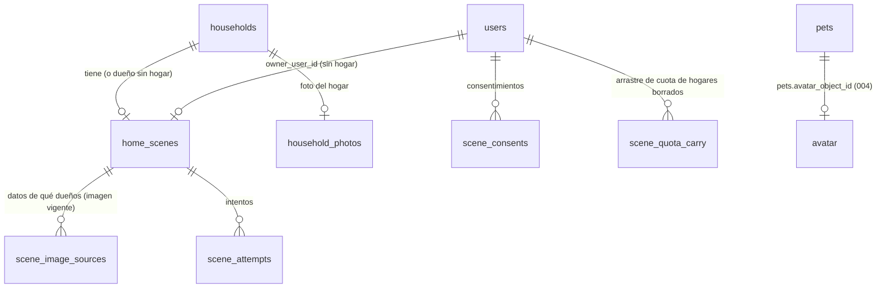

# Modelo de datos: Escena visual del hogar (Feature 006)

**Estado**: `DRAFT` (Architect, 2026-11-18; revisión 2 tras los informes de `/mifune`, `/trinity`, `/lock`, `/link` y `/merovingian`). Deltas sobre 002, 004 y 005 (`LOCKED`; no se editan). Las migraciones son **Nivel 2** (`N2-06` y `N2-08` firmadas), se escriben en SQLite y Postgres con prueba de paridad y las numera `/keymaker`: en disco SQLite llega a `0012_share_links.sql` y Postgres a `0008_share_links.sql`, por lo que las de la 006 serían **SQLite `0013` y Postgres `0009`** (`H-MERO-006-14`). Fechas: `TEXT` ISO-8601 UTC con milisegundos, por `ClockPort`. Identificadores: UUID de `IdGeneratorPort`. Este documento no crea migraciones ni toca `src/`.

**Cambios de la revisión 2** (resumen): estado derivado en lectura, sin proyección persistida (`H-MIF-006-01`); la imagen vigente vive en columnas de `home_scenes`, sin tabla `scene_images` (`H-MIF-006-02`); columnas muertas eliminadas (`H-MIF-006-08`); intento con `result_object_id`, `claimed_at`, `phase`, `quota_*`, `actor_user_id` (`H-LCK-006-02/03/04/07/08`, `H-TRI-006-02/05/07`); tabla `scene_quota_carry` (`H-LCK-006-12`); retención e idempotencia con vigencia (`H-TRI-006-16`). `scene_attempts` se conserva como tabla (`H-MIF-006-03` acotado por decisión de Neo el 2026-11-18: solo se recuerda la **última** clave de idempotencia de la escena, 24 h; los intentos se conservan 30 días, `N2-11`).

## 1. Vista lógica

| Entidad del spec | Realización física |
|---|---|
| `HomeScene` | tabla `home_scenes` (incluye las columnas `image_*` de la imagen vigente, `D6-13` = A: a lo sumo una) |
| `SceneReference` (`HOUSEHOLD_PHOTO`) | tabla `household_photos` |
| `SceneReference` (`PET_PHOTO`) | **vista lógica**, sin tabla: es `pets.avatar_object_id` de 004 (`D6-07` = A). La «referencia de mascota» de la escena es un puntero calculado; purgarla (`REQ-ESC6-030`) significa retirarla de las entradas de la escena y de las imágenes derivadas, **no** borrar el avatar, que es dato de la mascota y de su propietario |
| `SceneGenerationAttempt` | tabla `scene_attempts` |
| `ConsentRecord` (`SceneConsent` del spec) | tabla `scene_consents` |
| Cuota | columnas `consumed_generations` y `quota_window` de `home_scenes` y, para hogares borrados, `scene_quota_carry` |
| Imagen vigente | columnas `image_*` de `home_scenes` + objeto en Cloud Storage |

Total de tablas nuevas: **6** (`home_scenes`, `scene_image_sources`, `scene_attempts`, `household_photos`, `scene_consents`, `scene_quota_carry`).

## 2. Tablas

### 2.1 `home_scenes`
| Columna | Tipo | Restricción |
|---|---|---|
| `id` | `TEXT` | PK (UUID) |
| `household_id` | `TEXT` | NULL, FK `households(id)` ON DELETE CASCADE |
| `owner_user_id` | `TEXT` | NULL, FK `users(id)` ON DELETE CASCADE (escena sin hogar, `D6-09`) |
| | | `CHECK ((household_id IS NULL) <> (owner_user_id IS NULL))` (exactamente uno) |
| `run_state` | `TEXT` | NULL, `CHECK (run_state IN ('generating','failed'))`. **Es lo único del estado que se persiste** (`H-MIF-006-01`); NULL = sin intento en curso ni fallo vigente. Los estados `idle`, `outdated` y `ready` no se guardan: se **derivan** en lectura (§4) |
| `current_attempt_id` | `TEXT` | NULL, **sin FK declarada** (evita el ciclo con `scene_attempts`; lo garantizan la transacción y la prueba de paridad). Intento en curso (`run_state = 'generating'`) o último intento fallido (`run_state = 'failed'`); nulo si `run_state` es nulo (`CHECK`) |
| `lease_expires_at` | `TEXT` | NULL; no nulo solo con `run_state = 'generating'` (`CHECK`). En **T1** vale `ahora + T_QUEUE` (espera máxima en cola, constante 600 s); el **claim** del worker lo reescribe a `claimed_at + T_LEASE` (`H-LCK-006-03`) |
| `image_id` | `TEXT` | NULL; UUID; clave derivada `scenes/{id}/images/{image_id}` (sin nombre de usuario, `INV-ESC6-009`). Es también la etiqueta de caché (`imageTag`, `INV-ESC6-019`) |
| `image_mime` | `TEXT` | NULL, `CHECK (image_mime IN ('image/png','image/webp'))` |
| `image_size_bytes` | `INTEGER` | NULL, `CHECK (image_size_bytes > 0)` |
| `image_fingerprint` | `TEXT` | NULL; SHA-256 hex (64) de `image_inputs_snapshot` |
| `image_inputs_snapshot` | `TEXT` | NULL; JSON canónico de las entradas con que se generó (§2.6); 1-16 384 bytes |
| `image_created_at` | `TEXT` | NULL |
| | | `CHECK`: las seis columnas `image_*` son todas NULL o todas no nulas |
| `image_degraded` | `INTEGER` | NOT NULL DEFAULT 0, `CHECK (image_degraded IN (0,1))`; 1 si la imagen vigente se generó con una referencia degradada (`EDGE-ESC6-028`); la derivación del estado nunca la muestra como `ready` |
| `consumed_generations` | `INTEGER` | NOT NULL DEFAULT 0, `CHECK (consumed_generations >= 0)` |
| `quota_window` | `TEXT` | NOT NULL, patrón `YYYY-MM` en `APP_TIMEZONE` de la última generación exitosa (o de creación) |
| `created_at`, `updated_at` | `TEXT` | NOT NULL |

Eliminadas respecto de la revisión 1: `status` (derivado), `current_image_id` y la tabla `scene_images` (sin ciclo de claves), `last_generated_at` (equivale a `image_created_at`), `schema_version` (el snapshot lleva `"v": 1`).

Índices únicos parciales: `(household_id) WHERE household_id IS NOT NULL` y `(owner_user_id) WHERE owner_user_id IS NOT NULL` (una escena por hogar y por propietario sin hogar).

**La huella actual no se guarda**: se calcula siempre (función pura `computeFingerprint`). Tampoco se guarda el estado `idle|outdated|ready`.

### 2.2 Imagen vigente (columnas `image_*`)
`D6-13` = A: a lo sumo **una** imagen visible como vigente por escena; al publicar la nueva, las columnas `image_*` se sobrescriben y la clave anterior se encola para borrado, todo en la misma transacción. La puerta a un historial de versiones (`D6-13` = B/C) queda fuera de alcance (`spec.md` «Fuera»); si se firmara, se crearía la tabla entonces con una migración.

### 2.3 `scene_image_sources` (de qué dueños proviene la imagen vigente)
| Columna | Tipo | Restricción |
|---|---|---|
| `scene_id` | `TEXT` | FK `home_scenes(id)` ON DELETE CASCADE |
| `owner_user_id` | `TEXT` | NOT NULL; sin FK; se **seudonimiza** (HMAC) en la eliminación de cuenta, como `assigned_by_user_id` de 002 |
| | | PK `(scene_id, owner_user_id)` |

Registra qué usuarios aportaron una **foto efectivamente enviada** (foto del hogar, avatares que viajaron tras los filtros de consentimiento, límites y degradación; consentimiento `D6-16`) a la imagen vigente. **Decisión de Fase 5 (lote 2), 2026-11-18 (`H-KEY-F5-6`)**: mascotas enviadas sin foto, fotos omitidas o degradadas y el actor sin foto propia no figuran aquí. **Decisión de Fase 5 (lote 3), 2026-11-18**: las fuentes de la imagen vigente son las **fotos enviadas en su generación más las fuentes heredadas de la imagen previa cuando se usó como referencia** (modos `INCREMENTAL_*`; unión con las fuentes de la imagen previa): la imagen previa contiene visualmente a esa mascota, así que retirar el consentimiento de su dueño debe purgar la imagen nueva aunque su foto no viaje en esta generación (`REQ-ESC6-025`). Sin referencia a la imagen previa (regeneración completa) no se hereda. Para el consentimiento en T2 la herencia no exige consentimiento vigente (`D6-16` solo alcanza a fotos enviadas en esta generación); un dueño que ya retiró su consentimiento no puede constar, porque su retiro purgó la imagen. Se reemplaza completo en cada publicación (con la unión indicada) y se vacía cuando la imagen se retira. Lo usan el retiro de consentimiento, la desasignación, la transferencia de propiedad y la importación para decidir si la imagen vigente debe purgarse (`D6-17` = A, `REQ-ESC6-025`, `REQ-ESC6-030`). Sin nombres ni contenido.

### 2.4 `household_photos`
| Columna | Tipo | Restricción |
|---|---|---|
| `household_id` | `TEXT` | PK, FK `households(id)` ON DELETE CASCADE (una foto por hogar, `REQ-ESC6-001`) |
| `object_id` | `TEXT` | NOT NULL (UUID, nuevo en cada reemplazo); clave `households/{household_id}/photo/{object_id}`. Sirve de etiqueta de caché (`tag`), por eso no hay columna `version` (`H-MIF-006-08`) |
| `mime` | `TEXT` | NOT NULL, `CHECK (mime IN ('image/jpeg','image/png','image/webp'))` |
| `size_bytes` | `INTEGER` | NOT NULL, `CHECK (size_bytes > 0)` |
| `uploaded_by_user_id` | `TEXT` | NOT NULL; sin FK; seudonimizada (HMAC) al eliminar la cuenta |
| `created_at` | `TEXT` | NOT NULL |

Sin `original_name`: nunca se guarda el nombre del archivo (`INV-ESC6-009`, `SC-ESC6-052`). La foto cuenta en la cuota de 1 GiB del **propietario del hogar** (`REQ-ARC-005`); las escenas no. Hoy `countBytesOfOwner` (004: puerto de repositorio, in-memory, SQLite y Postgres) suma solo `pet_media`: la 006 exige ampliarlo a `pet_media` + `household_photos` de los hogares que el usuario posee (`H-MERO-006-13`; enmienda MINOR (c) aprobada de `N2-06`). El límite de megapíxeles y de bytes de la subida se aplica en la ruta de la 006 (`REQ-ESC6-027`).

### 2.5 `scene_attempts`
| Columna | Tipo | Restricción |
|---|---|---|
| `id` | `TEXT` | PK (UUID); es el `attemptId` de la tarea y el nombre de la tarea de la cola |
| `scene_id` | `TEXT` | NOT NULL, FK `home_scenes(id)` ON DELETE CASCADE |
| `actor_user_id` | `TEXT` | NOT NULL; sin FK; usuario que pulsó; seudonimizada (HMAC) al eliminar su cuenta; base del contador por actor (`REQ-ESC6-034`) |
| `action` | `TEXT` | NOT NULL, `CHECK (action IN ('UPDATE','REGENERATE'))` |
| `mode` | `TEXT` | NOT NULL, `CHECK (mode IN ('FROM_SCRATCH','INCREMENTAL_ADD','INCREMENTAL_REMOVE','INCREMENTAL_REPLACE','INCREMENTAL_MIXED','REGENERATE'))` |
| `fingerprint` | `TEXT` | NOT NULL; SHA-256 hex de `inputs_snapshot`, fijada al **inicio** (`REQ-ESC6-014`) |
| `inputs_snapshot` | `TEXT` | NOT NULL; JSON canónico de las entradas fijadas al inicio (§2.6); el worker arma el payload desde aquí, no desde el estado vivo |
| `result_object_id` | `TEXT` | NOT NULL; UUID del objeto resultante, **fijado en T1** en la misma transacción que la fila `INTENT`; el worker lo lee y no genera otro (`H-LCK-006-02`) |
| `phase` | `TEXT` | NOT NULL, `CHECK (phase IN ('PENDING','RUNNING','DONE'))`; el worker pasa `PENDING -> RUNNING` con compare-and-set antes de leer referencias o llamar al proveedor (`H-TRI-006-07`, `H-LCK-006-04`) |
| `claimed_at` | `TEXT` | NULL hasta el claim; el arrendamiento se cuenta desde aquí (`H-LCK-006-03`) |
| `provider_call_started_at` | `TEXT` | NULL; instante justo antes de la llamada al proveedor; evidencia para el contador de costo (`H-TRI-006-07`) |
| `quota_window` | `TEXT` | NOT NULL; ventana `YYYY-MM` imputada **en T1** (`EDGE-ESC6-031`) |
| `quota_max` | `INTEGER` | NOT NULL; valor de `ARGOS_SCENE_QUOTA_MAX` **fijado en T1**; T2 no lo relee de la configuración (`H-LCK-006-07`) |
| `outcome` | `TEXT` | NULL mientras corre; `CHECK (outcome IN ('SUCCEEDED','FAILED','CANCELLED'))` |
| `error_code` | `TEXT` | NULL; solo códigos estables (`ERR-SCENE-*`); **nunca** prompt, respuesta ni mensaje del proveedor (`INV-ESC6-016`) |
| `degraded` | `INTEGER` | NOT NULL DEFAULT 0, `CHECK (degraded IN (0,1))`; 1 si el worker degradó una referencia (`EDGE-ESC6-028`) |
| `idempotency_key_hash` | `TEXT` | NULL; SHA-256 hex de `actorId ‖ sceneId ‖ action ‖ clave` (el mismo hash de `REQ-ESC6-012`, el OpenAPI y `scene.schema`; la misma clave con otra `action` da `422`, `EDGE-ESC6-016`; la clave no se guarda, `C8`); se pone a NULL a las 24 h (`REQ-ESC6-012`) y **también cuando se inserta un intento posterior de la misma escena (T1): solo se recuerda la última clave**; los intentos anteriores se conservan sin hash |
| `idempotency_expires_at` | `TEXT` | NULL; `started_at + 24 h` |
| `started_at`, `finished_at` | `TEXT` | NOT NULL / NULL |

Índices: único parcial `(idempotency_key_hash) WHERE idempotency_key_hash IS NOT NULL` (el hash ya incluye actor y escena; `EDGE-ESC6-016`, `H-TRI-006-05`; como T1 anula el hash de los intentos previos de la escena, a lo sumo una fila por escena lo conserva); `(scene_id, started_at)` y `(actor_user_id, started_at)` para los contadores de `REQ-ESC6-034`.

Sin `duration_ms` (ningún REQ ni SC lo lee; la duración va a los registros, `REQ-ESC6-021`, `H-MIF-006-08`). **Retención**: los intentos terminales se conservan 30 días y se purgan en el mantenimiento diario (ratificado por Neo, `N2-11`); los hashes de clave caducan a las 24 h (SC-ESC6-095).

### 2.6 `inputs_snapshot` (JSON canónico, no es una tabla)
Hace falta para el recuento **por entidad** de cambios pendientes (`REQ-ESC6-004`) y para decidir el modo y las acciones `KEEP/ADD/REMOVE/REPLACE`: un hash solo no permite saber **qué** cambió. Contenido: `{ "v": 1, "household": <objectId de la foto efectiva | null>, "pets": [ { "id", "species", "speciesOther", "breed", "breedCode", "sex", "photo": <objectId del avatar efectivo | null> } ] }`, con `pets` en el orden de selección (`D6-11`), claves ordenadas y sin espacios (misma entrada, mismos bytes). **No contiene** nombres de mascota ni de usuario, microchip, fechas ni datos clínicos (`INV-ESC6-010`, `INV-ESC6-016`); `breed` y `speciesOther` son los textos libres ya sanitizados (`INV-ESC6-011`). `fingerprint` = SHA-256 hex de esta cadena (`domain/audit/sha256.ts`, puro). El campo `v` es la única versión del snapshot (no hay columna aparte).

### 2.7 `scene_consents`
| Columna | Tipo | Restricción |
|---|---|---|
| `id` | `TEXT` | PK (UUID) |
| `user_id` | `TEXT` | NOT NULL, FK `users(id)` ON DELETE CASCADE |
| `scope` | `TEXT` | NOT NULL, `CHECK (scope IN ('HOUSEHOLD_PHOTO','PET_PHOTOS'))` |
| `provider_id` | `TEXT` | NOT NULL, 1-64 |
| `notice_version` | `TEXT` | NOT NULL, 1-32 |
| `granted_at` | `TEXT` | NOT NULL |
| `revoked_at` | `TEXT` | NULL |

Índice único parcial `(user_id, scope, provider_id, notice_version) WHERE revoked_at IS NULL`. Un consentimiento está **vigente** si `revoked_at IS NULL`, su `notice_version` y su `provider_id` son los vigentes (constantes de código del cliente y del servidor, `H-MIF-006-06`). Se conserva al retirarlo (prueba de la retirada); se borra en cascada con la cuenta.

### 2.8 `scene_quota_carry` (la cuota no se reinicia al recrear el hogar, `EDGE-ESC6-033`)
| Columna | Tipo | Restricción |
|---|---|---|
| `owner_user_id` | `TEXT` | NOT NULL, FK `users(id)` ON DELETE CASCADE |
| `quota_window` | `TEXT` | NOT NULL, `YYYY-MM` |
| `consumed_generations` | `INTEGER` | NOT NULL, `CHECK (consumed_generations >= 0)` |
| | | PK `(owner_user_id, quota_window)` |

Al **eliminar un hogar** de propiedad del usuario, la misma transacción hace `UPSERT` con `consumed_generations := max(valor previo, consumed_generations de la escena)` para la ventana vigente de la escena. Al **crear un hogar** como propietario, `home_scenes.consumed_generations` y `quota_window` nacen con el arrastre de la ventana vigente (0 si no hay fila). La cuota de **hogares vivos** sigue siendo independiente (`SC-ESC6-057`, `D6-03`). El mantenimiento diario borra las filas de ventanas anteriores. Límite conocido: borrar la cuenta y crear otra reinicia el arrastre (`RR-06-12`; lo acota el tope global, `N2-02`).

## 3. Cuota (`D6-03`, `REQ-ESC6-011`, `INV-ESC6-004`)
- Ámbito: la fila `home_scenes` (hogar, o propietario sin hogar), con arrastre por hogares borrados (§2.8).
- `windowOf(now, APP_TIMEZONE)` = `YYYY-MM`; el dominio recibe la ventana ya resuelta (la conversión de zona vive detrás del reloj inyectado; sin `Date` ni `Intl` en `domain/`, `INV-ARCH-001`; `[verificar]` con `/keymaker` qué expone `ClockPort`). **Restante** = `max(0, Q − (quota_window = windowOf(now) ? consumed_generations : 0))`, con `Q` = `ARGOS_SCENE_QUOTA_MAX`. La vista muestra `resetsAt` (inicio de la ventana siguiente).
- **La ventana y el máximo se fijan en T1** (`scene_attempts.quota_window`, `quota_max`). **T2** comprueba `consumed < quota_max` **sobre la ventana del intento**, no sobre el reloj ni la configuración de ese momento: así una generación iniciada el 30-nov que termina el 1-dic se imputa a noviembre, y un cambio de `ARGOS_SCENE_QUOTA_MAX` o un despliegue entre T1 y T2 no descarta una llamada ya pagada (`EDGE-ESC6-031`, `H-LCK-006-07/08`). Si en T2 `consumed >= quota_max` sobre esa ventana (solo por fusión o arrastre de cuota entre T1 y T2, `D6-09`), el intento queda `FAILED` con `ERR-SCENE-GENERATION-FAILED`, sin descontar cuota y con la imagen anterior intacta; el motivo interno `SCENE_QUOTA_AT_T2` consta solo en la fila de auditoría, no es un `ERR-*`, no entra al catálogo ni a `SceneView.lastError` (`H-KEY-F5-7`).
- Publicación exitosa (misma transacción que escribe `image_*`): si `home_scenes.quota_window <> attempt.quota_window` entonces `quota_window := attempt.quota_window`, `consumed_generations := 1`; si no, `consumed_generations := consumed_generations + 1`.
- Fallos, timeouts, cancelaciones y duplicados no escriben `consumed_generations`. Una generación `degraded` publicada **sí** consume (hay imagen publicada).
- Prueba de reinicio mensual y de frontera con `ClockPort` fijo (`SC-ESC6-057`, `SC-ESC6-074`).

## 4. Estado derivado y huella (`H-MIF-006-01`; `REQ-ESC6-003`)
- No existe proyección `status` persistida ni `recomputeSceneStatus`. `getScene` y `requestSceneGeneration` calculan el estado con la función pura `deriveStatus` sobre: `run_state`, `lease_expires_at`, `now`, `fingerprintNow` (de `computeFingerprint` sobre el estado vivo), `image_fingerprint`, existencia de `image_id`, `image_degraded` y si hay entradas.
- Reglas (en este orden): (1) `run_state = 'generating'` y `lease_expires_at > now` → `generating`; (2) `generating` con arrendamiento vencido → se materializa `failed` con `ERR-SCENE-LEASE-EXPIRED` por compare-and-set idempotente (§7) y se devuelve `failed`; (3) `run_state = 'failed'` → `failed`, salvo que `fingerprintNow` difiera de la huella del intento fallido (`current_attempt_id`), en cuyo caso `outdated` (`failed -> outdated`, `EDGE-ESC6-014`); (4) `image_degraded = 1` → `outdated`; (5) hay imagen y `fingerprintNow = image_fingerprint` → `ready`; (6) hay entradas (huella distinta de la vacía) → `outdated`; (7) en otro caso → `idle`.
- La máquina cerrada de `contracts/state-machines/home-scene.machine.json` sigue siendo el contrato de las 8 transiciones lógicas; lo persistido es solo `generating|failed`.
- Se conservan en las transacciones de la causa **solo** las acciones de privacidad que no son de estado: retiro de la imagen (`image_*` a NULL, vaciar `scene_image_sources`) y encolado de borrados (`D6-17`, `REQ-ESC6-025/029/030`), la migración `D6-09`, la cascada de hogar y cuenta y el arrastre de cuota. Esos ganchos tocan casos de uso `LOCKED` de 002/004/005: **enmienda pendiente** (`plan.md` §1.2, `N2-06`); no se editan aquí.
- Cualquier cambio de entradas (importación, purga de avatares, cambio de `ARGOS_SCENE_MAX_PETS` por despliegue) se refleja en la siguiente lectura sin ganchos de estado (`H-LCK-006-14` queda resuelto por diseño).

## 5. Migraciones
| Orden | Contenido | Datos |
|---|---|---|
| M-1 | `home_scenes`, `scene_attempts`, `scene_image_sources`, `household_photos`, `scene_consents`, `scene_quota_carry` e índices, en ese orden (sin ciclos de claves foráneas: `home_scenes.current_attempt_id` no declara FK) | Sin datos: las escenas se crean de forma perezosa en el primer `GET` autorizado o en el primer cambio de entradas |
| M-2 | Ninguna columna nueva en `pets`, `households`, `pet_assignments` ni `pet_media` | — |
| M-3 (`N2-06` (a), aprobada) | Reconstrucción del `CHECK` de `audit_log` para los `entity_type` `HOME_SCENE`, `SCENE_CONSENT` y `HOUSEHOLD_PHOTO`, en SQLite recreando la tabla (precedente `0009_pet_media.sql`) y en Postgres con `ALTER`; va en `0013` (SQLite) y `0009` (Postgres) junto con M-1, con su propia tarea y suite | Conserva los datos de `audit_log` |

Paridad (`H-MERO-006-14`): ampliar en `schema-parity.spec.ts` `CANONICAL_TABLES` (23 → 29) y `CANONICAL_INDEXES`, declarar la ruta Postgres nueva, y ajustar `sqlite-migration-marker`, `postgres-pool`, `postgres-maintenance` y `t542-retencion-cero` (ninguna columna `deleted_at`). La purga de intentos y de arrastres de ventanas viejas es regla nueva del mantenimiento.

**`D6-09` migración al crear el primer hogar**, orden fijo en la transacción de creación (`household-use-cases`; `EDGE-ESC6-030`, `H-LCK-006-13`). **Orden normativo (Decisión de Fase 5, 2026-11-18, `H-KEY-F5-4`)**: si ya existe una fila `home_scenes` del hogar nuevo (creada por un gancho previo), se **elimina primero** esa escena sobrante (no puede tener imagen) y **después** se ejecuta el `UPDATE`; el orden «UPDATE primero, fusión después» queda sustituido porque `home_scenes` tiene un índice único parcial por hogar y otro por propietario (`household_id` único donde no es nulo): el `UPDATE ... SET household_id = :h` chocaría con la fila sobrante antes de poder fusionarla. El resultado observable es idéntico (una sola escena en el hogar, la del propietario con su imagen, cuota y ventana; la sobrante desaparece); alternativa rechazada: diferir el índice o relajarlo, que debilita `INV-ESC6-003`. Pasos: (1) crear el hogar; (2) si existe una escena del propietario por migrar **y** una escena sobrante con `household_id = :h`, eliminar la sobrante (sin escena del propietario no se borra nada); (3) `UPDATE home_scenes SET household_id = :h, owner_user_id = NULL WHERE owner_user_id = :u` (0 o 1 fila; si hay fila, la imagen, `consumed_generations` y `quota_window` migran sin llamada a la IA; `consumed_generations := max(consumed_generations, arrastre de la ventana)`); (4) queda una sola fila con `household_id = :h`: la migrada (la sobrante ya se eliminó en (2), sin imagen); el borrado precede al `UPDATE`. Una escena de propietario sin hogar que no migra (el usuario ya tenía un hogar propio antes de que existiera una escena) sigue siendo del propietario y solo muestra sus mascotas no asignadas (limitación declarada, `INT-06-04`). La huella del hogar nuevo solo incluye las mascotas **asignadas a él**: la afirmación «la huella no cambia» de `REQ-ESC6-032` vale solo si 002 asigna las mascotas del propietario al crear el hogar `[verificar contra 002]`; si no, la escena migrada queda con cambios pendientes (`R-06-B`).

## 6. Reglas de borrado y cascadas (`C7`, `REQ-ESC6-029`)
Todas las eliminaciones de objetos usan `media_deletion_queue` de 004 (`reason = 'DELETE'`) **dentro de la transacción de la causa**; el `delete` en GCS es posterior e idempotente. Tras el `COMMIT`, el caso de uso intenta el borrado inmediato de los objetos de escena (mejor esfuerzo) y la cola lo reintenta: objetivo de ejecución ≤ 60 s para filas `reason = DELETE` de escena (`H-TRI-006-06`; `[verificar]` el mecanismo de drenaje de 004); una URL firmada ya emitida vive hasta su TTL (300 s, `RR-06-05`). Orden de candados: propietario → mascota → hogar → escena (decisión de arquitectura, `plan.md` §1.2).

| Evento | Efecto en la base | Objetos en GCS a encolar |
|---|---|---|
| Reemplazar o borrar la foto del hogar | `household_photos` actualiza o borra (la escena queda `outdated` por derivación) | clave de la foto anterior |
| Publicar una imagen nueva (`D6-13` = A) | `image_*` se sobrescribe; `scene_image_sources` se reemplaza | clave de la imagen anterior |
| Eliminar una mascota | si la mascota aportó a la imagen vigente (por `image_inputs_snapshot`), `D6-17` = A: se retira la imagen vigente | avatar (ya lo encola 004); imagen vigente si procede |
| Desasignar mascota (`REQ-HOUSE2-002`: salida, expulsión) | la imagen vigente se retira siempre (`image_*` a NULL, `D6-17` = A) y se purga de inmediato | imagen vigente |
| Retirar consentimiento (`REQ-ESC6-025`) | `revoked_at`; si consta en `scene_image_sources` (es decir, su foto viajó al proveedor en la generación de la imagen vigente, `H-KEY-F5-6`), retiro y purga de la imagen; si no consta (dueño de mascota sin foto enviada, foto omitida o degradada), la imagen **se conserva**; en ambos casos se purgan sus referencias propias y los intentos en vuelo que contienen sus datos pasan a `CANCELLED` | imagen vigente; foto del hogar si la subió él |
| **Transferencia de propiedad** (`ownership-use-cases`, `H-MERO-006-15`) | se retiran las imágenes vigentes cuyo `image_inputs_snapshot` incluya la mascota transferida **y** cuyas `scene_image_sources` incluyan al propietario anterior (su foto viajó; si la foto de la mascota no viajó, la imagen se conserva, `H-KEY-F5-6`); el consentimiento de la foto de referencia pasa a ser el del nuevo Propietario Legal (`REQ-ESC6-024`) | imagen retirada |
| **Importación de respaldo** (`backup-use-cases`, `H-MERO-006-15`) | la importación reemplaza mascotas y deja `avatar_object_id = NULL`: se retira la imagen vigente de toda escena cuyo `image_inputs_snapshot` incluya mascotas reemplazadas (`REQ-ESC6-022`: queda sin imagen) | imagen retirada |
| Eliminar el hogar | `ON DELETE CASCADE` de `home_scenes`, `scene_attempts`, `scene_image_sources`, `household_photos`; **antes** del `DELETE`: encolar objetos y hacer `UPSERT` en `scene_quota_carry` (§2.8) | foto del hogar e imagen (patrón de `REQ-GCS-004`) |
| Eliminar la cuenta | cascada de `scene_consents`, `scene_quota_carry` y `home_scenes` (sin hogar); seudonimización de `scene_image_sources.owner_user_id`, `household_photos.uploaded_by_user_id` y `scene_attempts.actor_user_id` restantes (B10) | foto e imagen que le pertenezcan |
| Generación en vuelo (`EDGE-ESC6-021`) | **T1**, en la misma transacción que el intento: `INSERT media_deletion_queue (scenes/{sceneId}/images/{result_object_id}, 'INTENT')`; **T2** al publicar: `DELETE` de la fila `INTENT`. Si la escena, el hogar o la cuenta desaparecen, o se retira el consentimiento, o falla la verificación de T2, o vence el arrendamiento: la fila pasa a `DELETE` en la transacción que cierra el intento | objeto huérfano |
| Conciliación diaria | `/internal/maintenance` **añade** los prefijos `scenes/` y `households/` a la lista de conciliación de 004 (`REQ-GCS-004`; no es una segunda rutina, `H-MIF-006-11`) y encola con `DELETE` todo objeto de estos prefijos con antigüedad > 15 min que no esté en `home_scenes.image_id`, `household_photos`, `INTENT` ni en la cola (un worker zombi puede subir un objeto tras el vencimiento, `H-LCK-006-11`) | huérfanos |

Ventana residual: PITR y volcados (`RR-06-07`).

## 7. Reglas de consistencia
| Regla | Mecanismo |
|---|---|
| Un solo generador por escena (`INV-ESC6-003`) | **T1**: `UPDATE home_scenes SET run_state='generating', current_attempt_id=:a, lease_expires_at=:now+T_QUEUE WHERE id=:s AND (run_state IS NULL OR run_state='failed' OR (run_state='generating' AND lease_expires_at <= :now))` más la condición de negocio (cambios pendientes, o fallo previo, o sin imagen, o `REGENERATE`); 0 filas = respuesta con el estado vigente. SQLite `BEGIN IMMEDIATE`; Postgres `SELECT … FOR UPDATE` de la fila de la escena |
| Claim del worker (`H-LCK-006-03/04`, `H-TRI-006-07`) | `UPDATE scene_attempts SET phase='RUNNING', claimed_at=:now WHERE id=:a AND scene_id=:s AND phase='PENDING'`; 0 filas = el worker responde 204 sin leer referencias ni llamar al proveedor. En la misma transacción: `UPDATE home_scenes SET lease_expires_at = :now + T_LEASE WHERE id=:s AND current_attempt_id=:a AND run_state='generating'`. Antes de llamar al proveedor se escribe `provider_call_started_at` |
| Entrega para escena o intento inexistente o ajeno (`H-LCK-006-18`, `H-TRI-006-01`) | 204 sin efecto ni mensaje distinto (sin oráculo); el `attemptId` debe pertenecer al `sceneId` |
| Vencimiento del arrendamiento | `run_state='generating' AND lease_expires_at <= :now` → `failed` con `ERR-SCENE-LEASE-EXPIRED`, intento `FAILED`, fila `INTENT` a `DELETE`, sin consumir cuota; CAS idempotente que ejecutan la lectura (después de autorizar, nunca para hogares ajenos) y el mantenimiento diario (`H-TRI-006-12`); **si el CAS transiciona, la misma transacción escribe la auditoría `SCENE_FAILED` (`ERR-SCENE-LEASE-EXPIRED`) con el actor del intento expirado, una sola vez** (Decisión de Fase 5 lote 2, `H-KEY-F5-5`) |
| Publicación atómica (`INV-ESC6-004/005`) | **T2**, bajo el candado de la escena: (1) `current_attempt_id = :a`, `phase='RUNNING'`, arrendamiento vigente (contado desde el claim); (2) recomputar el **conjunto de dueños de datos** de las entradas fijadas en el intento (propietario legal de cada avatar incluido, quien subió la foto del hogar) y exigir para cada uno cuenta existente y mascota asignada y vigente, y consentimiento vigente solo del actor y de los dueños de fotos enviadas (driver real; `H-KEY-F5-6`); si falta alguno: intento `CANCELLED`, fila `INTENT` a `DELETE`, **no se publica** (`EDGE-ESC6-025`); (3) `consumed_generations < attempt.quota_max` sobre `attempt.quota_window`; si falla: intento `FAILED` con `ERR-SCENE-GENERATION-FAILED`, sin cuota, motivo interno `SCENE_QUOTA_AT_T2` solo en auditoría (`H-KEY-F5-7`); (4) `UPDATE home_scenes` (`image_*` del intento, `image_degraded` = `attempt.degraded`, cuota, `run_state := NULL`, `current_attempt_id := NULL`); (5) reemplazar `scene_image_sources`; (6) encolar la imagen anterior; (7) borrar la fila `INTENT`; (8) cerrar el intento (`phase='DONE'`, `outcome='SUCCEEDED'`). Si cualquiera falla: `rollback` y la imagen anterior queda intacta |
| Comprobación antes del `put` (`H-LCK-006-11`) | el worker verifica la señal de aborto de la solicitud y el arrendamiento vigente inmediatamente antes de `put`; un worker cortado por Cloud Run no sube objetos tras el vencimiento |
| `outdated` tras generar (`REQ-ESC6-014`) | no se guarda: la derivación compara `computeFingerprint(estado vivo)` con `image_fingerprint` en cada lectura |
| Referencia degradada (`EDGE-ESC6-028`) | si el worker no pudo leer una referencia (404 real tras un reintento de lectura) o la omitió por límite agregado, `scene_attempts.degraded = 1`; T2 publica con `image_degraded = 1` y la derivación nunca devuelve `ready` hasta la siguiente generación; en modo incremental sin escena previa el intento falla sin cuota (el worker no cambia de modo) |
| Sin escrituras en el dominio (`INV-ESC6-012`) | la generación solo escribe tablas de §2 |
| Contadores de intentos (`REQ-ESC6-034`) | T1 cuenta filas de `scene_attempts` por escena y por actor dentro de las ventanas definidas, bajo el candado de la escena; rechazo con `ERR-RATE-LIMITED` (429). **Decisión de Fase 5, 2026-11-18 (`H-KEY-F5-3`)**: el tope de 3 por escena cuenta **solo** filas con `result = 'FAILED'` y `started_at >= now - 24 h`; el puerto `countFailedAttemptsByScene(sceneId, since)` devuelve `{ count, oldestAt }` con `oldestAt` = el menor `started_at` de esas filas (o `null` si `count = 0`); al alcanzar 3, `Retry-After` = `oldestAt + 24 h - now` (segundos, redondeo hacia arriba). Los demás topes siguen contando intentos iniciados (`countAttemptsByScene` para el enfriamiento de 60 s y el tope de 12 por actor). Alternativa rechazada: contar todos los intentos de la escena (un usuario con intentos exitosos quedaría bloqueado sin haber fallado, contra `REQ-ESC6-034` (2)) |

## 8. Auditoría y registros
`REQ-AUD-001` registra evento y `householdId` en forma opaca (HMAC), `mode`, número de mascotas y código de resultado; nunca prompt, bytes, nombres ni claves de objeto (`REQ-ESC6-021`, `INV-ESC6-016`); en los eventos de consentimiento, el `actorId` opaco (`H-TRI-006-08`). Los eventos nuevos (`SCENE_REQUESTED`, `SCENE_PUBLISHED`, `SCENE_FAILED`, `SCENE_CONSENT_GRANTED`, `SCENE_CONSENT_REVOKED`, `HOUSEHOLD_PHOTO_CHANGED`) **no caben** en los enums cerrados de `audit-entry.schema.json` 3.1.0 ni en el `CHECK` de `audit_log` de 004 (`H-MERO-006-11`). Mapeo **aprobado en `N2-06` (a)**: `entity_type` nuevos `HOME_SCENE`, `SCENE_CONSENT` y `HOUSEHOLD_PHOTO` con los `mutation_type` existentes (`CREATE`, `UPDATE`, `DELETE`), y el evento concreto en el campo de detalle opaco. La enmienda tiene su propia tarea y suite en `tasks.md`; sin ella la 006 no escribe auditoría.
